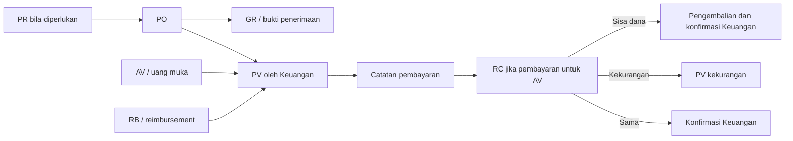

# BSD — Business/System Design

**Status:** draf 0.1. Peraturan berikut berasal dari gambar/formulir dan percakapan email hingga 4 November 2026; perlu validasi terhadap panduan v4 dan operasi aktual.

## Peta proses

Hubungan GR → PV, banyaknya pembayaran per induk dan rincian exception memerlukan konfirmasi; diagram tidak menyatakan GR selalu wajib. Untuk pembayaran rutin dan mobilisasi dapat ada PO tanpa PR pada kondisi yang disebut di bawah.

## Alur umum

1. Pemohon menyimpan draf dengan jenis, cabang, tujuan, anggaran, nilai dan lampiran relevan. Dokumen induk dapat dipilih ketika berlaku.
2. Submit memvalidasi data dan eligibility, membuat nomor unik, serta menetapkan snapshot aturan dan tahap penyetuju. Tahap pertama dipilih pemohon pada formulir saat ini; batas kewenangan pemilih perlu ditetapkan.
3. Penyetuju menerima tugas dan mengambil keputusan. Penolakan/return menyertakan alasan; riwayat mempertahankan keputusan serta komentar. Sistem saat ini mencatat skip saat penyetuju sudah menyetujui di tahap sebelumnya.
4. Setelah persetujuan akhir, Keuangan memperoleh akses dan membuat PV jika diperlukan. Persetujuan dokumen tidak berarti pembayaran sudah dilakukan.
5. Pembayaran dicatat dengan bukti, jumlah, tanggal dan informasi sumber dana sesuai otorisasi. Nilai catatan yang tidak sama dengan PV dikembalikan beserta alasan menurut email 31 Oktober; aturan perbedaan, toleransi dan pembayaran parsial perlu konfirmasi.
6. Pengajuan, persetujuan, lampiran, pembayaran dan hasil disimpan sebagai jejak yang dapat ditelusuri; akses paket audit dibatasi.

## Aturan teramati

| ID | Aturan dari snapshot | Dampak / hal yang perlu dikonfirmasi |
|---|---|---|
| BR-01 | Beranda menyebut Rp50.000.000 per pengajuan; lebih tinggi memakai cara lama. | Konfirmasi apakah kebijakan yang tetap berlaku atau batas solusi; jangan hilangkan secara otomatis. |
| BR-02 | Bagian IAM pada PR menyebut ≥ Rp5.000.000 sebelum pajak. Formulir PO juga menyebut ParentPRID pada total ≥ Rp5 juta. | Konfirmasi dasar ambang setiap jenis, IAM, dan validasinya. |
| BR-03 | PO pembayaran rutin/mobilisasi tidak memerlukan PR, IAM, nomor kontrak meski ≥ Rp5 juta; invoice wajib; mobilisasi tetap melalui empat tahap dalam email. | Pastikan kategori dan nama lampiran yang berlaku; jangan memecah tagihan untuk menghindari aturan. |
| BR-04 | Metode pembayaran PO wajib; jika transfer, bank, nomor dan nama rekening wajib. Nomor/tanggal invoice PV disebut opsional. | Verifikasi aturan untuk metode lain dan jenis induk lain. |
| BR-05 | Semua pembayaran lewat PV; induk PO/AV/RB dipilih, data dan rekening diteruskan. Email berikutnya menambah PV untuk kekurangan RC. | Pastikan aturan total/parsial, beberapa PV per induk, dan perbaikan data rekening. |
| BR-06 | Jumlah terutang = total − PPh menurut email; subtotal, biaya lain, diskon dan PPN dicatat. | Rumus total lengkap, basis pajak, kurs dan pembulatan memerlukan persetujuan Keuangan. IDR digunakan pada snapshot. |
| BR-07 | Alur persetujuan definitif (dikonfirmasi pengguna 7 November 2026): **Atasan Langsung → Bu Ayu → BOD (Pak Hery & Hashimoto)**. HR **tidak terlibat** dalam persetujuan pengadaan dan pembayaran. Catatan historis email 28 Okt/4 Nov yang menyebut HR adalah catatan sementara/usulan lama yang tidak digunakan. | Berlaku untuk semua dokumen transaksi pengadaan dan pembayaran sebelum diteruskan ke Keuangan untuk pembuatan PV dan pencatatan pembayaran. |
| BR-08 | RC: satu AV yang sudah dibayar untuk satu RC; pilih AV sendiri. Nilai CA diambil dari PV yang dibayar. | Tentukan perlakuan pembatalan, pengajuan ulang, dan pembayaran AV parsial. |
| BR-09 | RC: biaya kurang dari CA → lampirkan bukti pengembalian, Keuangan konfirmasi; lebih besar → rekening pegawai dan PV selisih; sama → bukti realisasi dan konfirmasi Keuangan. | Pastikan kapan kewajiban dianggap selesai dan ketentuan pajak atas selisih. |
| BR-10 | RC diajukan paling lambat dua hari kerja setelah tanggal kegiatan selesai; pengingat harian kerja kepada pemohon dan atasan, CC Bu Ayu, sampai RC diajukan. AV lama tidak otomatis diingatkan menurut email. | Kalender hari libur, zona waktu, jam kirim, penerima notifikasi pada sistem baru, serta definisi hari kerja perlu ditetapkan. |
| BR-11 | Bukti kuitansi/struk harus scan berwarna; email menyebut penyetuju mengembalikan bukti hitam putih. | Sistem dapat membantu pemeriksaan, tetapi pemeriksaan warna otomatis bukan bukti keaslian. |
| BR-12 | Setelah persetujuan akhir ada PDF ringkasan/riwayat; PV dibayar dibuat paket audit, akses dibatasi. | Validasi isi, penanda dokumen dan hak akses saat ini. |
| BR-13 | Email 4 November menyebut PO dengan kata "realisasi" di judul/tujuan ditolak otomatis untuk mengalihkan ke RC. | Validasi kebutuhan dan potensi salah tolak; usulkan tipe proses eksplisit sebagai alternatif. |

## Status usulan

- **Dokumen:** draft → submitted/in_review → approved atau returned; returned dapat menghasilkan revisi/pengajuan ulang yang berelasi. Pembatalan dan editing setelah submit perlu kebijakan.
- **Tugas:** pending → approved/rejected/skipped; reason wajib untuk reject, skipped memiliki alasan dan aktor sistem.
- **Pembayaran PV:** unpaid → paid sesuai catatan yang telah diterima; status partial/void hanya setelah kebijakan disepakati. Status ini terpisah dari status persetujuan.
- **RC:** menunggu persetujuan → konfirmasi Keuangan atau PV selisih sesuai hasil; status akhir dan pemulihan jika dana tidak cocok perlu keputusan.

## Rancangan tingkat dan kelompok persetujuan

**Dikonfirmasi pengguna untuk rancangan (7 November 2026):** Alur persetujuan operasional adalah **Atasan Langsung → Bu Ayu (Verifikator Keuangan) → BOD (Pak Hery & Hashimoto)**. **HR tidak terlibat** dalam persetujuan pengadaan maupun pembayaran. Ambang batas Rp5.000.000 adalah murni aturan lampiran memo IAM (pada PR) dan keharusan ParentPRID (pada PO), bukan pemotong alur persetujuan. Seluruh dokumen transaksi wajib melalui persetujuan penuh hingga BOD (Pak Hery & Hashimoto, keduanya menyetujui secara paralel). Satu orang dapat memiliki peran fungsional dan peran persetujuan (seperti Ayu sebagai verifikator/penyetuju dan tim Keuangan).

**Rantai Tahapan Persetujuan Definitif:**
1. **Tahap 1:** Atasan Langsung pemohon (persetujuan kelayakan operasional).
2. **Tahap 2:** Bu Ayu (verifikasi kelayakan administratif & keuangan).
3. **Tahap 3:** BOD: Pak Hery & Hashimoto (otorisasi direksi secara paralel). Seluruh dokumen transaksi wajib disetujui hingga Tahap 3 sebelum diteruskan ke Keuangan untuk pembuatan PV dan pembayaran.

Saat kedua tugas dibuat paralel, tiap tugas memiliki assignee, status dan keputusan sendiri; persetujuan satu orang belum menyelesaikan kelompok. Jika salah satu menolak, apakah langsung menghentikan alur dan apa yang terjadi pada tugas lain adalah keputusan terbuka. Catat waktu, aktor dan alasan penolakan; tangani keputusan bersamaan secara atomik. Penugasan pengganti, pengajuan ulang dan pemisahan tugas memerlukan kebijakan.

**Perilaku lama yang diamati, belum tentu dipertahankan:** Capture 013 menunjukkan skip karena penyetuju sudah menyetujui, tahap tidak dipakai jenis dokumen, atau penyetuju sama dengan pemohon. Alasan tersebut harus dibedakan; skip tidak boleh dianggap bukti persetujuan atau otomatis memenuhi kewajiban Hery/Hashimoto. Konfirmasi aturan pengganti dan self-approval sebelum implementasi.

**Keuangan pada RC:** email 3 November mengusulkan satu anggota Finance cukup mengonfirmasi untuk pengembalian sisa atau realisasi sama, sedangkan kekurangan diproses lewat PV; pengumuman 4 November menyebut konfirmasi Finance secara umum. Cabang yang tepat dan kewenangan orang yang merangkap peran perlu diverifikasi terhadap panduan v4. Rincian lain, masukan dan bukti ada di [temuan email dan hak akses](TEMUAN-EMAIL-DAN-HAK-AKSES.md).

## Validasi bisnis sebelum implementasi

Matriks per jenis/cabang/nilai; definisi masing-masing IAM, budget type, vendor master dan GR; kapan approval boleh didelegasikan; jumlah PV dan pembayaran; kebutuhan revisi; kebijakan data rekening; izin dokumen dan ekspor; formula nominal dan pajak; batas sistem; dokumen yang wajib pada tiap kategori; aturan hari libur dan transisi data lama.
