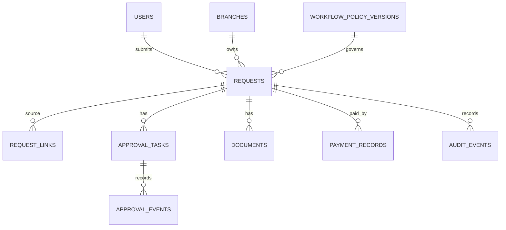

# DBD — Database Design

**Status:** model konseptual 0.1, belum siap untuk migrasi fisik. PostgreSQL diusulkan; nama tabel/kolom masih dapat berubah. Detail dokumen, aturan keuangan dan retensi harus diverifikasi.

## Relasi inti

`request_links` juga mereferensikan request tujuan; arah dan tipe relasi divalidasi server (PO→PR, AV→PO, PV→PO/AV/RB/RC, RC→AV). Diagram hanya menunjukkan salah satu sisi relasi untuk keterbacaan. GR dapat dimodelkan sebagai request bertipe GR atau entitas terpisah setelah aturannya diketahui.

## Tabel awal

| Tabel | Kolom inti dan maksud |
|---|---|
| `users`, `roles`, `user_roles`, `branches`, `user_branch_access` | Identitas Entra stabil menurut tenant + object ID, peran dan cakupan; satu orang dapat memiliki beberapa peran. Simpan periode efektif/status penugasan dan riwayat perubahan; tingkat kewenangan bukan izin implisit. Bentuk fisik cakupan/atribut belum final. |
| `requests` | UUID, nomor unik, jenis PR/PO/AV/RB/RC/PV/GR, judul, tujuan, branch_id, applicant_id, budget_type, status, policy_version_id, version, submitted_at, created_at, updated_at. |
| `request_amounts` | request_id, currency, subtotal, biaya lain, diskon, PPN, PPh, total, amount_due; snapshot rumus/versi. |
| `request_details` | Tabel detail bertipe PR/PO/AV/RB/RC/PV dengan kolom khusus dan foreign key; jangan menyembunyikan semua aturan utama dalam JSON tanpa constraint. |
| `request_links` | source_request_id, target_request_id, relation_type; FK keduanya, validasi jenis dan status tujuan. |
| `workflow_policy_versions` | versi, scope/jenis/cabang, konfigurasi disetujui, published_by/at, effective period; immutable setelah publish. |
| `approval_tasks` | request_id, referensi tahap/kelompok, nomor tahap, assignee_id, status, version, created_at, responded_at. Penugasan saat submit dicatat; hak akun tetap dicek saat keputusan. |
| `approval_events` | task_id, actor_id atau aktor sistem, outcome, comment, occurred_at, event key unik; riwayat append-only. |
| `documents` | request_id, object_key privat, nama asli, media type, ukuran, hash, kategori, uploaded_by/at, scan status, version. Metadata bukan isi berkas. |
| `payment_records` | PV request_id, nilai aktual, tanggal, referensi bukti, aktor, status; koreksi disimpan sebagai event. Kebijakan partial belum diputuskan. |
| `audit_events` | entity type/id, action, actor, timestamp, perubahan yang aman, correlation id; pembatasan akses dan retensi. |
| `outbox_jobs` | event key unik, jenis, payload minimum, state, attempts, next_attempt_at, lease/locked_until, last_error; tidak mencatat rahasia. |
| `business_calendars`, `holidays` | kalender berversi, tanggal dan zona waktu untuk deadline dan pengingat. |

Untuk alur paralel, rancang entitas tahap/kelompok persetujuan dan tugas per penyetuju, dengan syarat penyelesaian berversi yang dapat mewakili **keduanya wajib** pada RB/RC. Simpan keputusan Hery dan Hashimoto terpisah agar satu keputusan tidak menyelesaikan kelompok. Representasi tahap, perubahan anggota, penyelesaian setelah penolakan dan apakah konfirmasi Finance memakai tugas yang sama atau entitas terpisah belum final. Riwayat peristiwa harus membedakan approve, reject, skip, reassignment dan alasan; jangan menghapus keputusan terdahulu ketika aturan atau personel berubah.

Pisahkan penyimpanan informasi rekening dan hak aksesnya; usulkan referensi ke rekening dengan versi/snapshot yang disetujui untuk mencegah perubahan diam-diam pada PV yang telah disetujui. Mekanisme enkripsi dan penyamaran tergantung hosting dan kebijakan.

## Integritas dan transaksi

- Primary key UUID dan nomor bisnis unik; penomoran dibangkitkan aman saat konkuren. Detail jenis dokumen wajib konsisten dengan `requests.type` melalui constraint/transaksi yang diuji.
- Nilai moneter menggunakan `numeric` dengan skala disetujui Finance atau integer unit terkecil; tanpa float. Currency eksplisit. Validasi jumlah nonnegatif dan formula sesuai tipe; jangan menetapkan rumus pajak tanpa persetujuan.
- Foreign key, index untuk daftar menurut cabang/pemohon/status/tanggal, tugas menurut assignee/status, dan pencarian nomor/induk. Row-level akses tetap ditegakkan aplikasi dan dapat diperkuat database bila dipilih.
- Satu RC aktif per AV menurut snapshot: partial unique index atau tabel relasi khusus, dengan definisi aktif/returned/revisi disepakati. Kunci dan constraint mencegah submit bersamaan meloloskan duplikasi.
- Buat keputusan persetujuan, status, audit dan outbox atomik. Gunakan `version` untuk konflik pembaruan; gunakan idempotency key unik per operasi dan aktor. Aturan pembayaran ganda/parsial memerlukan keputusan sebelum constraint final.
- Catatan historis tidak dihapus secara rutin; koreksi melalui event dan hubungan revisi, sesuai retensi dan kebijakan privasi. Backup file dan database diuji bersama.

## Migrasi dari sistem berjalan

Inventaris SharePoint lists/libraries, definisi flow, mapping ID/nomor, status, lampiran, riwayat, versi aturan, dan timestamp. Lakukan ekstraksi hanya dengan otorisasi, staging privat, pemeriksaan kelengkapan/hak akses, uji impor idempoten dan rekonsiliasi jumlah/baris/total serta sampel dokumen bersama Finance. Tentukan dokumen aktif: dilanjutkan di sistem lama hingga selesai atau dimigrasikan dengan snapshot tahap yang diverifikasi; jangan membuat ulang tugas/pembayaran ganda. Cutover dan rollback sesuai IPD.
