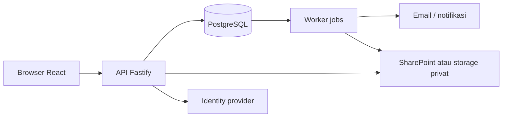

# TDD — Technical Design

**Status:** rancangan awal; pilihan teknologi usulan, bukan keputusan final. Pengguna memilih akun Microsoft 365 untuk masuk; pendaftaran dan izin organisasi, beban, hosting, dukungan internal dan rincian keamanan belum diketahui. Aplikasi saat ini hanya pratinjau draf lokal.

## Rekomendasi teknologi

- **Frontend:** React + TypeScript, Vite untuk SPA internal, komponen aksesibel dan design tokens. Router dan library form/validasi dipilih pada proof of concept, bukan dipatok sebelum kebutuhan diketahui.
- **Backend:** Node.js LTS + TypeScript + Fastify sebagai API modular. Node.js adalah runtime; Fastify adalah framework backend. Satu bahasa untuk frontend/backend, overhead relatif rendah dan ekosistem memadai; kemudahan tim lebih penting daripada klaim benchmark absolut.
- **Database:** PostgreSQL untuk transaksi, relasi dokumen, konsistensi dan audit. Gunakan tipe integer minor unit atau NUMERIC tepat; bukan floating point. ORM/query builder dipilih saat prototipe berdasarkan kemampuan transaksi dan migrasi.
- **File:** SharePoint organisasi diusulkan untuk lampiran melalui Microsoft Graph, dengan metadata dan kontrol akses di aplikasi. Pilihan ini memerlukan peninjauan hak akses dan izin admin; alternatifnya adalah object storage privat. Jangan taruh dokumen sensitif pada URL publik.
- **Background jobs:** mulai dari tabel job/outbox PostgreSQL dan worker terpisah dalam codebase yang sama; gunakan antrian tambahan hanya jika beban/operasional memerlukan. Worker mengirim notifikasi, membuat PDF dan memproses pengingat, dengan percobaan ulang yang aman.

Alternatif: Express lebih familiar dan sederhana jika tim sudah menguasai, tetapi lebih banyak pilihan middleware/manual; NestJS memberi struktur dan dependency injection bagi tim besar, dengan kompleksitas awal lebih tinggi. Usulan Fastify modular monolith menyeimbangkan kebutuhan sekarang; benchmark dan keterampilan tim perlu divalidasi. React + Node tidak mengharuskan microservices atau sistem workflow komersial.

## Komponen

Usulan satu aplikasi modular: identitas & akses, pengajuan, aturan dan persetujuan, dokumen, pembayaran & realisasi, pencarian/ekspor, dan notifikasi. Modul berbagi transaksi database tetapi memiliki batas layanan yang jelas. Jalur bank adalah pencatatan manual kecuali integrasi disepakati.

## Aturan workflow dan konsistensi

1. Saat submit, backend memvalidasi izin, kelengkapan dan syarat induk berdasarkan kebijakan aktif, serta membekukan versi kebijakan dan penugasan/tahap yang berlaku bagi pengajuan itu. Snapshot proses tidak mempertahankan hak akses akun yang kemudian dinonaktifkan atau dicabut.
2. Perubahan status, tugas berikutnya, catatan audit dan event outbox dibuat dalam transaksi yang sama. Tidak mengirim email atau membuat PDF dalam transaksi database.
3. Keputusan harus berasal dari pengguna yang berwenang pada tugas aktif. Gunakan optimistic version check atau penguncian untuk mencegah dua keputusan bersamaan; idempotency key untuk submit/keputusan/catatan bayar dan batas unik pada operasi yang relevan.
4. Worker menggunakan klaim job atomik, retry/backoff, batas percobaan dan daftar kegagalan; penyampaian email bisa lebih dari sekali, sehingga efek bisnis di sisi aplikasi harus idempoten. Pantau antrian dan kegagalan. Tidak menjanjikan exactly-once untuk email.
5. Perubahan kebijakan tidak mengubah pengajuan yang telah berjalan. Migrasi eksplisit berotorisasi, audit dan pengujian dibutuhkan jika ada pengecualian.
6. Job pengingat menyimpan deadline dan kalender versi yang digunakan; zona waktu bisnis, hari libur, jam kirim serta pengecualian AV lama perlu keputusan.

## Otorisasi dan persetujuan paralel — rancangan

- Pisahkan autentikasi Microsoft 365, peran aplikasi, tingkat kewenangan, cakupan akses, versi alur dan assignee tugas. Simpan identitas stabil tenant + object ID; nama untuk tampilan, bukan kunci izin. Hak diberikan eksplisit per tindakan dan cakupan, bukan berdasarkan angka tingkat semata. Pengguna bisa mempunyai beberapa peran.
- Backend memeriksa identitas aktif, izin tindakan dan cakupan objek pada setiap permintaan; untuk keputusan juga wajib ada tugas aktif yang ditugaskan kepada aktor. Tolak akses bila syarat tidak terpenuhi. Periksa akses pada API, dokumen, pencarian, notifikasi, ekspor dan paket audit aplikasi. Akses langsung SharePoint melewati backend, sehingga izin SharePoint harus selaras secara terpisah; jika hak granular tidak dapat diselaraskan, batasi akses langsung dan sajikan berkas melalui aplikasi yang memeriksa izin. Model dan izin tenant perlu diverifikasi bersama IT.
- Rancang tahap sebagai kelompok dengan tugas per aktor dan syarat penyelesaian yang ditentukan kebijakan. Untuk RB/RC, pengguna menyatakan Hery dan Hashimoto sama-sama diperlukan dan dapat paralel; satu persetujuan saja tidak menyelesaikan kelompok. Urutan lengkap, perilaku penolakan, pengganti, hak konfirmasi Ayu dan penerapan pada jenis lain masih belum diputuskan.
- Keputusan paralel menggunakan transaksi dan kontrol konkurensi agar masing-masing keputusan tercatat sekali, progres kelompok dihitung benar dan tindakan usang ditolak. Pencatatan, perubahan status dan outbox tetap atomik. Penolakan dan penanganan tugas paralel lain harus mengikuti kebijakan yang disahkan, bukan asumsi.
- Audit perubahan peran/cakupan/kebijakan, penugasan, delegasi dan keputusan dengan aktor/waktu/alasan. Penyetuju yang sama pada beberapa tahap, tahap tidak dipakai dan kasus pemohon sebagai penyetuju memerlukan aturan skip/pengganti yang disahkan; simpan alasan berbeda dan jangan menyamakan skip dengan approval.
- Perubahan aturan alur mempertahankan versi dan tugas yang melekat pada transaksi yang sudah masuk proses. Hak efektif diperiksa lagi saat aksi: pengguna yang haknya dicabut tidak boleh bertindak hanya karena pernah ditugaskan; prosedur reassignment yang aman dan diaudit masih perlu keputusan.
- Untuk lampiran SharePoint, tentukan model akses yang menjaga pemeriksaan hak per berkas dan mencegah pengguna memperoleh hak lebih luas melalui tautan langsung. Cara penerapannya, aplikasi yang didaftarkan, izin admin dan opsi akses terdelegasi perlu ditinjau bersama IT sebelum integrasi.

## Antarmuka API usulan

REST JSON versioned `/api/v1`; kontrak lengkap/OpenAPI, status error dan pagination diputuskan sebelum implementasi.

| Kelompok | Operasi |
|---|---|
| `/me`, `/tasks` | Profil, peran, daftar tugas dengan filter/cursor. |
| `/requests` | Buat/ubah draf, detail, submit dan riwayat; validasi per jenis pada server. |
| `/tasks/{taskId}/decisions` | Approve/reject untuk tugas aktif tertentu yang ditugaskan, alasan wajib ketika reject, versi dan idempotency key. Endpoint adalah usulan dan belum tersedia. |
| `/requests/{id}/documents` | Unggah, daftar dan unduh terotorisasi. |
| `/payments` | Catatan pembayaran PV yang disetujui, bukti, dan koreksi sesuai kebijakan. |
| `/admin/workflow-policies` | Draft, validasi, publikasi dan riwayat versi kebijakan; hak administratif terbatas. |
| `/reports` | Buku besar, ekspor dan paket audit berbatas hak. |

Jangan menerima peran, nominal terhitung, status, approver atau hak akses dari klien sebagai sumber kebenaran. Urutan validasi dan aturan error harus didokumentasikan dan diuji.

## Keamanan dan operasional

- Pengguna memilih masuk dengan akun Microsoft 365; implementasi yang diusulkan menggunakan Microsoft Entra ID/OIDC dan memerlukan pendaftaran aplikasi serta konfigurasi organisasi. Otorisasi pada server untuk peran, cabang, kepemilikan dan tiap dokumen. Verifikasi akses di setiap unduhan dan ekspor; log tanpa membocorkan nomor rekening atau token.
- TLS, enkripsi penyimpanan sesuai fasilitas hosting, secrets manager dan akses least privilege. File dibatasi jenis/ukuran, dipindai sesuai kebijakan, dan disajikan privat. Rekening ditampilkan hanya untuk peran berwenang.
- Audit append-only secara logis, dengan identitas, waktu, tindakan, versi dan perubahan relevan; pembatasan akses admin dan kebijakan retensi perlu disepakati. Tidak mengklaim ketahanan hukum atau anti-tamper absolut.
- Backup PostgreSQL dan file secara konsisten, uji restore, monitoring health/job/error dan prosedur incident. Target RPO/RTO, availability, kapasitas dan lokasi hosting menunggu pemilik sistem.
- Lingkungan dev/staging/production terpisah, data uji disamarkan, migrasi database terkontrol dan rollback rilis. UAT dengan Finance dan pemilik proses sebelum produksi.
- Aksesibilitas: keyboard, focus terlihat, label, error, warna serta kontras dan reduced motion; target WCAG yang formal ditentukan bersama.

## Batas rancangan

Tidak ada estimasi performa atau biaya dapat dipercaya tanpa volume, lampiran, konkurensi dan hosting. Keputusan tentang transaksi parsial, e-signature yang diakui, integrasi perbankan, data historis dan penggantian Odoo menunggu konfirmasi. Integrasi tidak diasumsikan otomatis.
