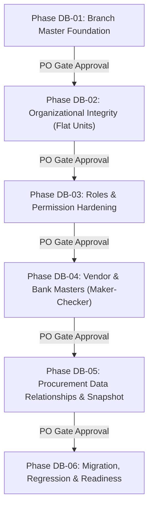

# DATABASE HARDENING PLAN & SECURITY SPECIFICATION — PHASE 00
## Financial Integrity, Security Controls & Implementation Roadmap (Tasks DBH-004, DBH-005, DBH-008)

**Project:** BLC Caready Procurement Pro  
**Document:** Financial Integrity, Security Controls & Implementation Roadmap  
**Status:** DESIGN FINALIZED — AWAITING IMPLEMENTATION APPROVAL  
**Scope:** Finalisasi REG-01–REG-06 dan DB-REVIEW-01–03  
**Implementation:** NOT AUTHORIZED  
**Production Migration:** LOCKED  
**Review Authority:** Project Manager & Product Owner  
**Date:** 10 November 2026  

---

## 1. Executive Summary

Dokumen ini merumuskan rencana perkuatan integritas data finansial, kontrol keamanan otorisasi, dan peta jalan implementasi (*implementation roadmap*) bertahap (**DB-01 hingga DB-06**) untuk sistem BLC Caready Procurement Pro v1. Dokumen telah diselaraskan penuh dengan seluruh keputusan Product Owner (**ADR-DB-001 s/d ADR-DB-007**, **REG-01 s/d REG-06**, serta **DB-REVIEW-01 s/d DB-REVIEW-03**).

> [!IMPORTANT]
> **Status: DESIGN FINALIZED — IMPLEMENTATION NOT AUTHORIZED.**  
> Dokumen ini berstatus spesifikasi arsitektur final. Rekomendasi awal terkait isolasi cabang ketat, unit organisasi hirarkis, dan pembatasan cabang rekening kas telah digantikan oleh keputusan final Product Owner. Tidak ada kode aplikasi atau migrasi skema yang boleh dieksekusi tanpa persetujuan implementasi resmi.

---

## 2. Integritas Data Finansial & Pembekuan Snapshot (Task DBH-004 & DB-REVIEW-02)

### 2.1. Audit Alur Rantai Dokumen Finansial
Sistem memproses rantai dokumen bertingkat yang memiliki validasi referensial ketat:

```mermaid
flowchart LR
    PR[1. Purchase Requisition] -->|parentPrId (1:1)| PO[2. Purchase Order]
    PO -->|parentPoId (1:N)| GR[3. Goods Receipt]
    PO -->|sourceDocId (1:1 aktif)| PV[4. Payment Voucher]
    AV[Advance Kasbon] -->|sourceDocId (1:1 aktif)| PV
    RB[Reimbursement] -->|sourceDocId (1:1 aktif)| PV
    PV -->|disetujui & dicairkan| PR_REC[5. Payment Record]
```

### 2.2. Aturan Validasi Dokumen Induk (Parent Document Rules):
1. **PR $\rightarrow$ PO:**
   - PR induk wajib berstatus `APPROVED`.
   - Nilai subtotal PO tidak boleh melampaui nilai subtotal PR induk (`PO_EXCEEDS_PR_AMOUNT`).
   - Nomor memo IAM pada PO wajib sama dengan nomor memo IAM pada PR (`PO_IAM_MISMATCH`).
   - Kardinalitas 1:1: Satu PR hanya boleh digunakan untuk satu dokumen PO aktif (`DUPLICATE_PO_FOR_PR`).
2. **PO $\rightarrow$ GR:**
   - PO induk wajib berstatus `APPROVED`.
   - GR barang wajib melampirkan foto barang (`PHOTO`), GR jasa wajib melampirkan BAST (`BAST`). GR selesai saat diajukan (*completion on submission*) tanpa antrean persetujuan approval palsu.
3. **PO / AV / RB $\rightarrow$ PV:**
   - Dokumen sumber wajib berstatus `APPROVED`.
   - PV dibuat melalui tindakan eksplisit Staf Keuangan (tidak otomatis terbit tanpa campur tangan manusia).
   - Satu dokumen sumber hanya boleh memiliki tepat satu PV aktif (`DUPLICATE_PV_FOR_SOURCE`).
   - Nilai bruto PV dihitung otomatis dari nilai dokumen sumber; potongan PPh dihitung sesuai tarif resmi.
4. **PV $\rightarrow$ Payment Record:**
   - PV wajib berstatus `APPROVED` dan berstatus pembayaran `UNPAID`.
   - Rekening sumber kas wajib merujuk ke entitas aktif pada `company_bank_accounts` (REG-06).
   - Nominal transfer pada Payment Record wajib sama persis hingga rupiah terakhir dengan nilai neto PV (`pv.netAmountToPay`).
   - Pencatatan pembayaran otomatis memicu pembaruan status pembayaran dokumen sumber menjadi `PAID`.

### 2.3. Pembekuan Snapshot Data Rekening Transaksi (DB-REVIEW-02):
- **PO Submission Snapshot:**
  - Saat PO disubmit, sistem menyalin dan membekukan snapshot rekening rekanan secara permanen (`vendor_id`, `legal_name`, `vendor_bank_account_id`, `bank_name`, `account_number`, `account_holder_name`, `snapshot_timestamp`).
  - Pembaruan master vendor pasca-submission tidak mengubah data rekening pada PO tersebut.
  - Perubahan rekening hanya boleh dilakukan melalui proses pengajuan revisi resmi, bukan penimpaan diam-diam (*silent overwrite*).
- **PV Transaction Context:**
  - Data rekening tujuan pada PV dari PO mengunci informasi dari transaksi PO yang telah disetujui, bukan mengambil nomor rekening terkini dari master vendor.
  - Pada submission PV, seluruh data penerima dan rekening dikunci kembali dalam konteks transaksi PV.
- **Payment Record Historical Link:**
  - Catatan pembayaran terhubung ke approved PV, rekening sumber BLC yang valid, nominal, tanggal, dan informasi rekening tujuan dari transaksi PV.
  - Perubahan master rekening di kemudian hari tidak mengubah bukti transaksi pembayaran historis.

---

## 3. Keamanan & Kontrol Otorisasi (Task DBH-005)

### 3.1. Matriks Otorisasi Berbasis Peran (RBAC Matrix)

| Aksi & Endpoint Master Data | Admin | Keuangan | Atasan | Pemohon | Direksi BoD |
|---|:---:|:---:|:---:|:---:|:---:|
| **Kelola Master Cabang (`/branches`)** | **CRUD** | Read-Only | Read-Only | Read-Only | Read-Only |
| **Penonaktifan Cabang (`/branches/:id/deactivate`)** | **Execute (REG-05)** | No Access | No Access | No Access | No Access |
| **Kelola Unit Organisasi Datar (`/units`)** | **CRUD** | Read-Only | Read-Only | Read-Only | Read-Only |
| **Kelola Penugasan Supervisor (`/assignments`)** | **CRUD** | Read-Only | Read-Only | Read-Only | Read-Only |
| **Kelola Master Pengguna & Verifikasi (`/users`)** | **CRUD** | Read-Only | Read-Only | Read-Only | Read-Only |
| **Kelola Master Vendor (`/vendors`)** | **CRUD (REG-01)** | Read-Only | Read-Only | Read-Only | Read-Only |
| **Maker–Checker Rekening Vendor (`/vendor-bank-requests`)**| **Maker/Checker (REG-02)**| Read-Only | No Access | No Access | No Access |
| **Kelola Rekening Kas Perusahaan (`/company-bank-accounts`)** | **CRUD (REG-06)** | **CRUD** | Read-Only | No Access | Read-Only |
| **Baca Dokumen Seluruh Cabang (`/documents`)** | **Read (REG-03)** | **Read** | **Read** | **Read** | **Read** |
| **Persetujuan Approval Tahapan (`/stages/:id/decide`)** | No Access | Per Assigned | Per Assigned | No Access | Per Assigned |
| **In-Flight Stage Reassignment (`/stages/:id/reassign`)**| **Execute** | No Access | No Access | No Access | No Access |
| **Penerbitan Payment Voucher (`/generate-pv`)** | No Access | **Execute** | No Access | No Access | No Access |
| **Pencatatan Pembayaran Kasir (`/payments/:pvId/record`)**| No Access | **Execute** | No Access | No Access | No Access |

### 3.2. Penegakan Otorisasi Kunci:
1. **Global Read Transparency vs. Strict Mutation (REG-03):** Seluruh pengguna terautentikasi dapat membaca dokumen lintas cabang, namun otorisasi persetujuan HANYA dimiliki oleh pengguna yang terdaftar pada `approval_stages.assigned_approver_id`. Hak membaca dokumen cabang lain tidak memberikan hak menyetujui dokumen tersebut.
2. **Maker–Checker Dual Control (REG-02):** Perubahan rekening vendor wajib diajukan oleh Admin (Maker) dan disetujui Admin lain (Checker). `maker_user_id !== checker_user_id`. Tidak ada auto-approval oleh Maker.
3. **Controlled Branch Deactivation (REG-05):** Admin ditolak menonaktifkan cabang jika cabang memiliki transaksi aktif atau kewajiban terbuka.
4. **Sanitasi & Masking Finansial:** Nomor rekening bank lengkap disamarkan (*masked*) pada tampilan publik; hanya pengguna dengan otorisasi audit/keuangan yang dapat melihat nomor rekening lengkap.
5. **Larangan Credential Logging:** Seluruh log audit (`before_json`/`after_json`) dilarang keras menyimpan password, hash, JWT token, atau credential sensitif lainnya.

---

## 4. Peta Jalan Implementasi Minimal (Task DBH-008)

Rencana implementasi dibagi menjadi enam (6) tahapan berurutan (*gated phases*). Setiap fase memiliki prasyarat pengujian terisolasi dan persetujuan Product Owner sebelum fase berikutnya dibuka:



### Rincian Fase Implementasi:

#### 1. DB-01 — Branch Master Foundation
- **Fokus:** Pembuatan tabel `branches` dan `branch_audit`, seeding 7 cabang resmi, penambahan kolom `app_users.primary_branch_id`, penegakan REG-05 (penolakan penonaktifan cabang aktif), dan API CRUD cabang khusus Admin.
- **Deliverable:** DDL migrasi cabang, isolated unit tests, seed cabang aktif.
- **Gate:** Verifikasi bahwa seluruh pengguna lama terpetakan ke `primary_branch_id` yang valid.

#### 2. DB-02 — Organizational Integrity (Flat Units)
- **Fokus:** Perluasan tabel `org_units` sebagai struktur datar (*flat*) tanpa `parent_unit_id` (REG-04), penambahan atribut `branch_id`, rekonsiliasi berbasis worksheet resmi `Organization_BLC` menggunakan identifier pengguna terverifikasi, dan audit penugasan divisi.
- **Deliverable:** Update repository organisasi, audit logger terintegrasi, 100% tes relasi unit lulus.

#### 3. DB-03 — Roles & Permission Hardening
- **Fokus:** Penegasan satu *primary application role* per pengguna (ADR-DB-003), pembuktian pembacaan global dokumen lintas cabang tanpa hak mutasi otomatis (REG-03), dan pembuktian isolasi antara global role dengan stage approval authority sesuai BR-APP-001.
- **Deliverable:** Security regression tests, validasi middleware otorisasi.

#### 4. DB-04 — Vendor & Bank Masters (Maker–Checker)
- **Fokus:** Pembuatan tabel `vendors`, `vendor_bank_accounts`, `company_bank_accounts` (global REG-06), dan `vendor_bank_account_change_requests` (Maker–Checker REG-02). Pembuatan API pengelolaan master vendor khusus Admin (REG-01).
- **Deliverable:** Deduplikasi nama vendor & rekening, validasi NPWP, tes Maker–Checker dengan `maker_user_id !== checker_user_id`.

#### 5. DB-05 — Procurement Data Relationships & Snapshot Integration
- **Fokus:** Integrasi formulir transaksi (PO, PV, dll.) ke master data baru. Pengubahan input teks bebas nama vendor menjadi dropdown vendor aktif. Pembekuan snapshot perbankan saat submission (DB-REVIEW-02). Validasi rekening kas aktif saat pelunasan PV.
- **Deliverable:** Integrasi repository dokumen dengan master SQLite, pembuktian kekebalan data historis.

#### 6. DB-06 — Migration, Regression & Readiness
- **Fokus:** Eksekusi skrip migrasi data terpadu pada lingkungan pengujian staging, verifikasi integritas penuh (`PRAGMA integrity_check;`, `PRAGMA foreign_key_check;`), verifikasi backup terkoordinasi (DB-REVIEW-03), verifikasi regresi 315 automated tests eksisting, dan pelaporan kesiapan produksi akhir (*Final Readiness Sign-off*).
- **Deliverable:** Migration verification report, rollback rehearsal evidence, PO sign-off.
