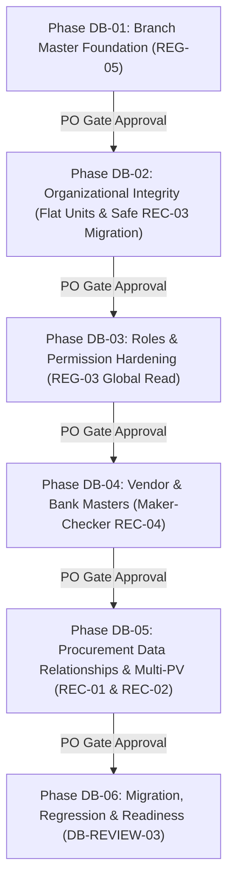

# DATABASE HARDENING PLAN & SECURITY SPECIFICATION — PHASE 00
## Financial Integrity, Security Controls & Implementation Roadmap (Tasks DBH-004, DBH-005, DBH-008 & REC-01 s/d REC-04)

**Project:** BLC Caready Procurement Pro  
**Document:** Financial Integrity, Security Controls & Implementation Roadmap  
**Status:** AUTHORIZED — DOCUMENTATION REVISION ONLY  
**Reference:** BLC Procurement Guide v3, November 2026  
**Scope:** Finalisasi REG-01–REG-06, DB-REVIEW-01–03, dan Rekonsiliasi REC-01–REC-04  
**Implementation:** LOCKED  
**Production Migration:** LOCKED  
**Review Authority:** Project Manager & Product Owner  
**Date:** 10 November 2026  

---

## 1. Executive Summary

Dokumen ini merumuskan rencana perkuatan integritas data finansial, kontrol keamanan otorisasi, dan peta jalan implementasi (*implementation roadmap*) bertahap (**DB-01 hingga DB-06**) untuk sistem BLC Caready Procurement Pro v1. Dokumen telah diselaraskan penuh dengan seluruh keputusan Product Owner (**ADR-DB-001 s/d ADR-DB-007**, **REG-01 s/d REG-06**, **DB-REVIEW-01 s/d DB-REVIEW-03**, dan **REC-01 s/d REC-04**).

> [!IMPORTANT]
> **Status: AUTHORIZED — DOCUMENTATION REVISION ONLY.**  
> Dokumen ini berstatus spesifikasi arsitektur final. Seluruh implementasi fisik dan migrasi database operasional berstatus **LOCKED** hingga otorisasi implementasi resmi dikeluarkan.

---

## 2. Integritas Data Finansial, Rantai Dokumen & Pembayaran Sebagian (Task DBH-004, REC-01 & REC-02)

### 2.1. Audit Alur Rantai Dokumen Finansial
Sistem memproses rantai dokumen bertingkat yang mencakup seluruh 7 jenis dokumen resmi (`PR`, `PO`, `AV`, `RB`, `RC`, `GR`, `PV`) dan catatan eksekusi `PaymentRecord`:

```mermaid
flowchart LR
    PR[1. Purchase Requisition] -->|parentPrId (1:1)| PO[2. Purchase Order]
    PO -->|parentPoId (1:N)| GR[3. Goods Receipt]
    PO -->|sourceDocId (1:N Bertahap REC-02)| PV_PO[4a. Payment Voucher PO]
    
    AV[Advance Kasbon] -->|sourceDocId (1:1)| PV_AV[4b. Payment Voucher AV]
    PV_AV -->|Pencairan Dana| PR_AV[Payment Record AV]
    PR_AV -->|Wajib Pertanggungjawaban| RC[5. Realisasi Kasbon / RC (REC-01)]
    RC -->|Outcome DEFICIT| PV_RC[4c. Payment Voucher Selisih RC]
    
    RB[Reimbursement] -->|sourceDocId (1:1)| PV_RB[4d. Payment Voucher RB]
    
    PV_PO -->|Eksekusi Pembayaran| PR_FIN[Payment Record Finansial]
    PV_RC -->|Eksekusi Pembayaran| PR_FIN
    PV_RB -->|Eksekusi Pembayaran| PR_FIN
```

### 2.2. Aturan Validasi Dokumen Induk & Saldo Terutang (Parent Rules & REC-02):
1. **PR $\rightarrow$ PO:**
   - PR induk wajib berstatus `APPROVED`.
   - Nilai subtotal PO tidak boleh melampaui nilai subtotal PR induk (`PO_EXCEEDS_PR_AMOUNT`).
   - Nomor memo IAM pada PO wajib sama dengan nomor memo IAM pada PR (`PO_IAM_MISMATCH`).
   - Kardinalitas 1:1: Satu PR hanya boleh digunakan untuk satu dokumen PO aktif (`DUPLICATE_PO_FOR_PR`).
2. **PO $\rightarrow$ GR:**
   - PO induk wajib berstatus `APPROVED`.
   - GR barang wajib melampirkan foto barang (`PHOTO`), GR jasa wajib melampirkan BAST (`BAST`). GR selesai saat diajukan (*completion on submission*) tanpa antrean persetujuan approval palsu.
3. **PO $\rightarrow$ PV (Pembayaran Bertahap / Multi-PV REC-02):**
   - PO induk wajib berstatus `APPROVED`.
   - PO mendukung beberapa PV (termin 1, termin 2, pelunasan sisa) selama nilai neto tidak melampaui sisa kewajiban:
     $$\text{Outstanding Balance} = \text{PO.totalAmount} - \sum \text{PV.netAmountToPay (status } \neq \text{'REJECTED', } \neq \text{'DRAFT')} - \sum \text{AV.amount (status } \neq \text{'REJECTED')}$$
   - Permintaan pembuatan PV baru dengan nilai melebihi `Outstanding Balance` ditolak dengan HTTP 422 `PV_EXCEEDS_SOURCE_AMOUNT`.
   - Jika suatu PV berstatus `REJECTED`, nilai komitmennya dilepaskan kembali ke `Outstanding Balance`.
   - Transisi status pembayaran PO:
     - `UNPAID`: Belum ada PV yang lunas dibayar.
     - `PARTIALLY_PAID`: Minimal 1 PV berstatus `PAID`, namun masih ada sisa saldo terutang.
     - `PAID`: Seluruh kewajiban PO telah lunas dicairkan (`Outstanding Balance == 0`).
4. **AV $\rightarrow$ PV $\rightarrow$ RC (Realisasi Kasbon REC-01):**
   - AV berstatus `APPROVED` menghasilkan tepat satu PV kasbon (1:1).
   - Setelah PV kasbon dicairkan (`PAID`), staf pemohon wajib mengajukan dokumen `RC` (*Realisasi Kasbon*) untuk mempertanggungjawabkan pengeluaran riil ([`src/components/forms/FormRC.tsx`](file:///C:/Users/Bernard/Documents/personal's%20project/BLC/src/components/forms/FormRC.tsx)):
     - `SURPLUS`: Realisasi < kasbon; pemohon mengembalikan sisa dana ke rekening perusahaan dan wajib melampirkan bukti setor (`REFUND_PROOF`).
     - `EXACT`: Realisasi == kasbon; diselesaikan tanpa transaksi kas lanjutan.
     - `DEFICIT`: Realisasi > kasbon; perusahaan berhutang kepada karyawan, sistem mengizinkan penerbitan satu PV selisih dengan `sourceDocType: 'RC_DEFICIT'`.
5. **RB $\rightarrow$ PV:**
   - RB berstatus `APPROVED` menghasilkan tepat satu PV penggantian (1:1).
6. **PV $\rightarrow$ Payment Record:**
   - PV wajib berstatus `APPROVED` dan berstatus pembayaran `UNPAID`.
   - Rekening kas sumber wajib merujuk ke entitas aktif pada `company_bank_accounts` (REG-06).
   - Nominal transfer pada Payment Record wajib sama persis hingga rupiah terakhir dengan nilai neto PV (`pv.netAmountToPay`).
   - Pencatatan pembayaran otomatis memicu kaskade pembaruan status pembayaran dokumen sumber menjadi `PAID` (atau `PARTIALLY_PAID` jika termin).
   - **Pemisahan Konsep:** `PaymentRecord` adalah artefak eksekusi pencatatan kas keluar, **bukan** jenis dokumen `DocType` dan **bukan** tahap approval baru.

---

## 3. Keamanan & Kontrol Otorisasi (Task DBH-005, REG-01 s/d REG-03, REC-04)

### 3.1. Matriks Otorisasi Berbasis Peran (RBAC Matrix)

| Aksi & Endpoint Master Data | Admin | Keuangan | Atasan | Pemohon | Direksi BoD |
|---|:---:|:---:|:---:|:---:|:---:|
| **Kelola Master Cabang (`/branches`)** | **CRUD** | Read-Only | Read-Only | Read-Only | Read-Only |
| **Penonaktifan Cabang (`/branches/:id/deactivate`)** | **Execute (REG-05)** | No Access | No Access | No Access | No Access |
| **Kelola Unit Organisasi Datar (`/units`)** | **CRUD** | Read-Only | Read-Only | Read-Only | Read-Only |
| **Kelola Penugasan Supervisor (`/assignments`)** | **CRUD** | Read-Only | Read-Only | Read-Only | Read-Only |
| **Kelola Master Pengguna & Verifikasi (`/users`)** | **CRUD** | Read-Only | Read-Only | Read-Only | Read-Only |
| **Kelola Master Vendor (`/vendors`)** | **CRUD (REG-01)** | Read-Only | Read-Only | Read-Only | Read-Only |
| **Maker Pengajuan Rekening (`POST /vendor-bank-requests`)**| **Maker (REC-04)** | Read-Only | No Access | No Access | No Access |
| **Checker Persetujuan Rekening (`PUT /vendor-bank-requests/:id`)**| **Checker (REC-04)**| No Access | No Access | No Access | No Access |
| **Kelola Rekening Kas Perusahaan (`/company-bank-accounts`)** | **CRUD (REG-06)** | **CRUD** | Read-Only | No Access | Read-Only |
| **Baca Dokumen Seluruh Cabang (`/documents`)** | **Read (REG-03)** | **Read** | **Read** | **Read** | **Read** |
| **Persetujuan Approval Tahapan (`/stages/:id/decide`)** | No Access | Per Assigned | Per Assigned | No Access | Per Assigned |
| **In-Flight Stage Reassignment (`/stages/:id/reassign`)**| **Execute** | No Access | No Access | No Access | No Access |
| **Penerbitan Payment Voucher (`/generate-pv`)** | No Access | **Execute** | No Access | No Access | No Access |
| **Pencatatan Pembayaran Kasir (`/payments/:pvId/record`)**| No Access | **Execute** | No Access | No Access | No Access |

### 3.2. Penegakan Otorisasi Kunci:
1. **Global Read Transparency vs. Scoped Mutation (REG-03):** Seluruh pengguna terautentikasi dapat membaca dokumen lintas cabang, namun otorisasi persetujuan HANYA dimiliki oleh pengguna yang terdaftar pada `approval_stages.assigned_approver_id`. Hak membaca dokumen cabang lain tidak memberikan hak menyetujui dokumen tersebut.
2. **Maker–Checker Dual Control (REG-02 & REC-04):** Perubahan rekening vendor wajib diajukan oleh Admin (Maker) dan disetujui Admin lain (Checker). Ditegakkan secara fisik oleh database constraint `maker_user_id <> checker_user_id` dan atomic conditional query `WHERE status = 'PENDING'`. Tidak ada auto-approval oleh Maker.
3. **Controlled Branch Deactivation (REG-05):** Permintaan penonaktifan cabang ditolak jika cabang masih memiliki transaksi aktif atau kewajiban terbuka.
4. **Sanitasi & Masking Finansial:** Nomor rekening bank lengkap disamarkan (*masked*) pada tampilan publik; hanya pengguna dengan otorisasi audit/keuangan yang dapat melihat nomor rekening lengkap.
5. **Larangan Credential Logging:** Seluruh log audit (`before_json`/`after_json`) dilarang keras menyimpan password, hash, JWT token, atau credential sensitif lainnya.

---

## 4. Peta Jalan Implementasi Minimal (Task DBH-008 & REC-01 s/d REC-04)

Rencana implementasi dibagi menjadi enam (6) tahapan berurutan (*gated phases*). Setiap fase memiliki prasyarat pengujian terisolasi dan persetujuan Product Owner sebelum fase berikutnya dibuka:



### Rincian Fase Implementasi:

#### 1. DB-01 — Branch Master Foundation
- **Fokus:** Pembuatan tabel `branches` dan `branch_audit`, seeding 7 cabang resmi, penambahan kolom `app_users.primary_branch_id`, penegakan REG-05 (penolakan penonaktifan cabang aktif), dan API CRUD cabang khusus Admin.
- **Deliverable:** DDL migrasi cabang, isolated unit tests, seed cabang aktif.
- **Gate:** Verifikasi bahwa seluruh pengguna lama terpetakan ke `primary_branch_id` yang valid.

#### 2. DB-02 — Organizational Integrity (Flat Units & REC-03 Safe Migration)
- **Fokus:** Migrasi aditif aman pada tabel eksisting `org_units` ([`server/organization.ts#L49`](file:///C:/Users/Bernard/Documents/personal's%20project/BLC/server/organization.ts#L49)) melalui deteksi `PRAGMA table_info`, penambahan kolom `code`, `branch_id`, `status`, `updated_at`, `updated_by`, upgrade `org_schema_version = 3`, dan rekonsiliasi berbasis worksheet resmi `Organization_BLC`.
- **Deliverable:** Script migrasi aditif idempoten, update repository organisasi, 100% tes relasi unit lulus.

#### 3. DB-03 — Roles & Permission Hardening
- **Fokus:** Penegasan satu *primary application role* per pengguna (ADR-DB-003), implementasi pembacaan global dokumen lintas cabang tanpa hak approval otomatis (REG-03), dan pembuktian isolasi antara global role dengan stage approval authority sesuai BR-APP-001.
- **Deliverable:** Security regression tests, validasi middleware otorisasi.

#### 4. DB-04 — Vendor & Bank Masters (Maker–Checker REC-04)
- **Fokus:** Pembuatan tabel `vendors`, `vendor_bank_accounts`, `company_bank_accounts` (global REG-06), dan `vendor_bank_account_change_requests` dengan constraint fisik database `maker_user_id <> checker_user_id` (REC-04). Pembuatan API pengelolaan master vendor khusus Admin (REG-01).
- **Deliverable:** Deduplikasi nama vendor & rekening, validasi NPWP, tes Maker–Checker dengan `maker_user_id !== checker_user_id`.

#### 5. DB-05 — Procurement Data Relationships, RC & Multi-PV Integration (REC-01 & REC-02)
- **Fokus:** Integrasi formulir transaksi (PO, PV, RC) ke master data baru. Pengubahan input teks bebas nama vendor menjadi dropdown vendor aktif. Pembekuan snapshot perbankan saat submission (DB-REVIEW-02). Implementasi multi-PV bertahap pada PO dengan batasan `Outstanding Balance` (REC-02). Integrasi siklus pertanggungjawaban kasbon `RC` (REC-01).
- **Deliverable:** Integrasi repository dokumen dengan master SQLite, pembuktian kekebalan data historis, tes kalkulasi saldo terutang PO.

#### 6. DB-06 — Migration, Regression & Readiness (DB-REVIEW-03)
- **Fokus:** Eksekusi skrip migrasi data terpadu pada lingkungan pengujian staging, verifikasi integritas penuh (`PRAGMA integrity_check;`, `PRAGMA foreign_key_check;`), verifikasi backup terkoordinasi (DB-REVIEW-03), verifikasi regresi 315 automated tests eksisting, dan pelaporan kesiapan produksi akhir (*Final Readiness Sign-off*).
- **Deliverable:** Migration verification report, rollback rehearsal evidence, PO sign-off.
