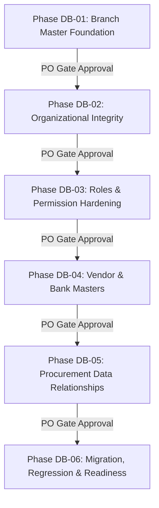

# DATABASE HARDENING PLAN & SECURITY SPECIFICATION — PHASE 00
**Project:** BLC Caready Procurement Pro  
**Document:** Financial Integrity, Security Controls & Implementation Roadmap (Tasks DBH-004, DBH-005, DBH-008)  
**Status:** IN REVIEW — HARDENING DESIGN  
**Review Authority:** Project Manager & Product Owner  
**Date:** 10 November 2026  

---

## 1. Executive Summary

Dokumen ini merumuskan rencana perkuatan integritas data finansial, kontrol keamanan otorisasi, dan peta jalan implementasi (*implementation roadmap*) bertahap (DB-01 hingga DB-06) untuk sistem BLC Caready Procurement Pro.

---

## 2. Integritas Data Finansial & Historis (Task DBH-004)

### 2.1. Audit Alur Rantai Dokumen Finansial
Sistem memproses empat relasi pengadaan bertingkat yang wajib memiliki validasi referensial ketat:

```mermaid
flowchart LR
    PR[1. Purchase Requisition] -->|parentPrId (1:1)| PO[2. Purchase Order]
    PO -->|parentPoId (1:N)| GR[3. Goods Receipt]
    PO -->|sourceDocId (1:1 aktif)| PV[4. Payment Voucher]
    AV[Advance Kasbon] -->|sourceDocId (1:1 aktif)| PV
    RB[Reimbursement] -->|sourceDocId (1:1 aktif)| PV
    PV -->|disetujui & dicairkan| PR_REC[5. Payment Record]
```

### 2.2. Aturan Validasi Dokumen Induk (Parent Document Rules):
1. **PR $\rightarrow$ PO:**
   - PR induk wajib berstatus `APPROVED`.
   - Nilai subtotal PO tidak boleh melampaui nilai subtotal PR induk (`PO_EXCEEDS_PR_AMOUNT`).
   - Nomor memo IAM pada PO wajib sama dengan nomor memo IAM pada PR (`PO_IAM_MISMATCH`).
   - Kardinalitas 1:1: Satu PR hanya boleh digunakan untuk satu dokumen PO aktif (`DUPLICATE_PO_FOR_PR`).
2. **PO $\rightarrow$ GR:**
   - PO induk wajib berstatus `APPROVED`.
   - GR barang wajib melampirkan foto barang (`PHOTO`), GR jasa wajib melampirkan BAST (`BAST`).
3. **PO / AV / RB $\rightarrow$ PV:**
   - Dokumen sumber wajib berstatus `APPROVED`.
   - Satu dokumen sumber hanya boleh memiliki tepat satu PV aktif (`DUPLICATE_PV_FOR_SOURCE`).
   - Nilai bruto PV dihitung otomatis dari nilai dokumen sumber; potongan PPh dihitung sesuai tarif resmi.
4. **PV $\rightarrow$ Payment Record:**
   - PV wajib berstatus `APPROVED`.
   - Nominal transfer pada Payment Record wajib sama persis hingga rupiah terakhir dengan nilai neto PV (`pv.netAmountToPay`).
   - Pencatatan pembayaran otomatis memicu kaskade pembaruan status pembayaran dokumen sumber menjadi `PAID`.

### 2.3. Pemisahan Status Persetujuan dan Status Pembayaran:
Sistem secara ketat memisahkan status persetujuan alur kerja (*Workflow / Approval Status*) dengan status realisasi kas (*Payment Status*):
- Status Dokumen: `DRAFT` $\rightarrow$ `SUBMITTED` $\rightarrow$ `IN_REVIEW` $\rightarrow$ `APPROVED` $\rightarrow$ `PAID`.
- Status Pembayaran: Kolom khusus `paymentStatus: 'UNPAID' | 'PAID'` pada PV.
- Persetujuan dokumen tidak otomatis mencairkan dana; pencairan dana wajib didokumentasikan oleh Staf Keuangan/Treasury melalui rekaman `PaymentDetails`.

### 2.4. Kekebalan Data Historis (Historical Preservation Strategy):
- Saat dokumen transaksi (PO atau PV) disubmit dan disetujui, informasi rekanan dan rekening bank difiksasi sebagai **immutable snapshot** di dalam dokumen.
- Jika di masa mendatang Administrator memperbarui nomor rekening atau nama vendor pada master data `vendors`, dokumen historis yang telah terbit **TIDAK AKAN BERUBAH SECARA RETROSPEKTIF**.

---

## 3. Keamanan & Kontrol Otorisasi (Task DBH-005)

### 3.1. Matriks Otorisasi Berbasis Peran (RBAC Matrix)

| Aksi & Endpoint Master Data | Admin | Keuangan | Atasan | Pemohon | Direksi BoD |
|---|:---:|:---:|:---:|:---:|:---:|
| **Kelola Master Cabang (`/branches`)** | **CRUD** | Read-Only | Read-Only | Read-Only | Read-Only |
| **Kelola Unit Organisasi (`/units`)** | **CRUD** | Read-Only | Read-Only | Read-Only | Read-Only |
| **Kelola Penugasan Supervisor (`/assignments`)** | **CRUD** | Read-Only | Read-Only | Read-Only | Read-Only |
| **Kelola Master Pengguna & Verifikasi (`/users`)** | **CRUD** | Read-Only | Read-Only | Read-Only | Read-Only |
| **Kelola Rekening Kas Perusahaan (`/company-bank-accounts`)** | **CRUD** | **CRUD** | Read-Only | No Access | Read-Only |
| **Kelola Master Vendor (`/vendors`)** | **CRUD** | **CRUD** | Read-Only | Read-Only | Read-Only |
| **In-Flight Stage Reassignment (`/stages/:id/reassign`)**| **Execute** | No Access | No Access | No Access | No Access |
| **Penerbitan Payment Voucher (`/generate-pv`)** | No Access | **Execute** | No Access | No Access | No Access |
| **Pencatatan Pembayaran Kasir (`/payments/:pvId/record`)**| No Access | **Execute** | No Access | No Access | No Access |

### 3.2. Kebijakan Privasi Data Audit (Audit Privacy & Sanitation):
1. **Larangan Keras Credential Logging:** Kolom `before_json` dan `after_json` pada seluruh tabel audit (`app_user_audit`, `org_assignment_audit`, `branch_audit`, dll.) **TIDAK BOLEH** menyimpan password, hash password, token JWT, secret key, atau session cookies.
2. **Sanitasi Data Rekening:** Nomor rekening bank pada tampilan umum disamarkan (*masked*), kecuali bagi Tim Keuangan dan Administrator yang memiliki hak otorisasi audit keuangan.
3. **Penanganan Pengguna Nonaktif:**
   - Pengguna dengan `status = 'INACTIVE'` ditolak saat login (HTTP 401).
   - Token JWT yang masih aktif dari pengguna yang baru dinonaktifkan akan ditolak pada middleware autentikasi karena server memvalidasi status pengguna terkini di database (`app_users.status === 'ACTIVE'`).

---

## 4. Peta Jalan Implementasi Minimal (Task DBH-008)

Rencana perkuatan database dibagi menjadi enam (6) tahapan berurutan (*gated phases*). Setiap fase memiliki prasyarat pengujian terisolasi dan persetujuan Project Manager & Product Owner sebelum fase berikutnya dibuka.



### Rincian Fase Implementasi:

#### 1. DB-01 — Branch Master Foundation
- **Fokus:** Pembuatan tabel `branches` dan `branch_audit`, migrasi 7 cabang resmi dari enum statis, penambahan kolom `app_users.primary_branch_id`, dan API CRUD cabang khusus Admin.
- **Deliverable:** DDL migrasi cabang, isolated unit tests, seed cabang aktif.
- **Gate:** Verifikasi bahwa seluruh pengguna lama terpetakan ke `primary_branch_id` yang valid.

#### 2. DB-02 — Organizational Integrity
- **Fokus:** Perluasan `org_units` (penambahan kolom kode unik dan parent unit opsional), validasi pencegahan hirarki melingkar (*loop prevention*), dan audit penugasan divisi.
- **Deliverable:** Update repository organisasi, audit logger terintegrasi, 100% tes relasi unit lulus.

#### 3. DB-03 — Roles & Permission Hardening
- **Fokus:** Penegasan satu *primary application role* per pengguna, proteksi otorisasi berbasis peran pada seluruh endpoint `/api/v1/*`, dan pembuktian isolasi antara global role dengan stage approval authority sesuai BR-APP-001.
- **Deliverable:** Security regression tests, validasi middleware otorisasi.

#### 4. DB-04 — Vendor & Bank Masters
- **Fokus:** Pembuatan tabel `vendors`, `vendor_bank_accounts`, `company_bank_accounts`, dan tabel audit terkait. Pembuatan API pengelolaan master vendor dan rekening BLC khusus Admin/Keuangan.
- **Deliverable:** Deduplikasi nama vendor & rekening, validasi NPWP, tes relasi 1:N vendor ke rekening.

#### 5. DB-05 — Procurement Data Relationships
- **Fokus:** Integrasi formulir transaksi (PO, PV, dll.) ke master data baru. Pengubahan input teks bebas nama vendor menjadi dropdown vendor aktif. Validasi rekening sumber saat pelunasan PV.
- **Deliverable:** Integrasi repository dokumen dengan master SQLite, pembuktian kekebalan data historis.

#### 6. DB-06 — Migration, Regression & Readiness
- **Fokus:** Eksekusi skrip migrasi data terpadu pada lingkungan pengujian staging, verifikasi integritas penuh (`PRAGMA integrity_check`), verifikasi regresi 315 automated tests eksisting, dan pelaporan kesiapan produksi akhir (*Final Readiness Sign-off*).
- **Deliverable:** Migration verification report, rollback rehearsal evidence, PO sign-off.
