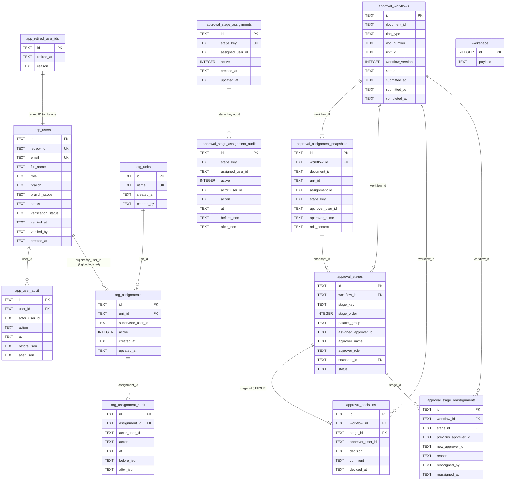
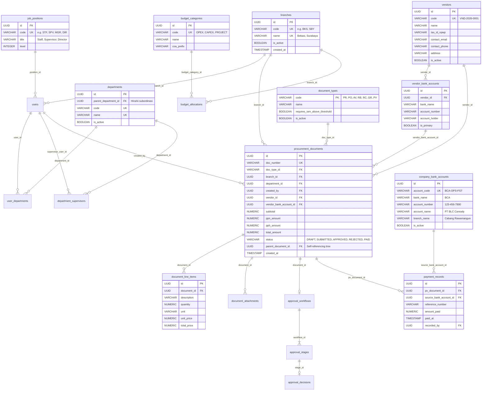

# DATABASE ENTITY RELATIONSHIP DIAGRAM — PHASE 00
**Project:** BLC Caready Procurement Pro  
**Audit Scope:** Physical, Logical, and Target Relationship Architecture (AUDIT-005)  
**Status:** AUTHORIZED — AUDIT ONLY  
**Review Authority:** Project Manager & Product Owner  
**Date:** 10 November 2026  

---

## 1. Overview & Batasan Arsitektur

Dokumen ini memetakan relasi entitas pada sistem BLC Caready Procurement Pro ke dalam tiga perspektif terpisah:
1. **Existing Physical Relationships**: Relasi tabel nyata yang dijamin oleh foreign key (FK) dan constraint fisik pada engine SQLite.
2. **Logical Relationships in Code**: Relasi data yang diatur secara logis pada lapisan aplikasi (*application-level integrity*) dan dokumen JSON di dalam tabel `workspace`.
3. **Proposed Target Relational Architecture**: Rancangan skema relasional terstandarisasi untuk rilis skala enterprise masa depan.

> [!WARNING]
> Relasi pada Diagram 1 dan Diagram 2 merepresentasikan implementasi kode saat ini. Diagram 3 adalah rekomendasi target arsitektur dan **belum diimplementasikan** pada database operasional.

---

## 2. Diagram 1: Hubungan Fisik Database Aktual (Physical SQLite Schema)

Diagram berikut menampilkan struktur 16 tabel relasional fisik di SQLite yang terhubung melalui Foreign Keys (`REFERENCES`) dan Partial Unique Indexes.



---

## 3. Diagram 2: Hubungan Logis Aplikasi & Dokumen JSON (Logical Data Architecture)

Diagram berikut merepresentasikan bagaimana entitas bisnis saling terhubung di tingkat logika kode aplikasi ([`server/repository.ts`](file:///C:/Users/BLC/orca/workspaces/blc-procurement/betta/server/repository.ts), [`server/app.ts`](file:///C:/Users/BLC/orca/workspaces/blc-procurement/betta/server/app.ts), dan model transaksi JSON):

```mermaid
flowchart TD
    subgraph Identity_Org["Identitas & Master Organisasi (SQLite)"]
        User["app_users (usr-*)"]
        Unit["org_units"]
        OrgAssign["org_assignments"]
        StageAssign["approval_stage_assignments"]
    end

    subgraph Static_Defs["Definisi Statis & Enums (TypeScript / JSX)"]
        BranchEnum["OFFICIAL_BRANCHES (7 Cabang)"]
        BudgetTypes["Budget Types (OPEX, CAPEX, PROJECT)"]
        DocTypeEnum["DocType (PR, PO, AV, RB, RC, GR, PV)"]
        MimeConst["ALLOWED_MIME_TYPES (PDF, PNG, JPEG)"]
    end

    subgraph Transaction_Docs["Dokumen Pengadaan (JSON di workspace.payload)"]
        PR["PR Document"]
        PO["PO Document"]
        GR["GR Document"]
        AV["AV Document"]
        RC["RC Document"]
        RB["RB Document"]
        PV["PV Document"]
        PaymentRecord["Payment Record Details"]
    end

    subgraph Filesystem["Storage Fisik Lampiran"]
        UploadDisk[".data/uploads/ (${id}-${safeName})"]
    end

    subgraph Workflow_Engine["Approval Engine (SQLite)"]
        WfInstance["approval_workflows"]
        WfSnapshots["approval_assignment_snapshots"]
        WfStages["approval_stages"]
        WfDecisions["approval_decisions"]
    end

    %% Relasi Identitas ke Dokumen
    User -->|ownerId / applicant| PR
    User -->|ownerId / applicant| PO
    User -->|ownerId / applicant| AV
    User -->|ownerId / applicant| RB
    User -->|Finance Staff| PV

    %% Relasi Organisasi ke Workflow
    Unit -->|unitId / supervisor lookup| OrgAssign
    OrgAssign -->|Stage 1 candidate| WfSnapshots
    StageAssign -->|Stage 2 & Stage 3 candidate| WfSnapshots

    %% Relasi Antar Dokumen Transaksi
    PR -->|parentPrId (1:1)| PO
    PO -->|parentPoId (1:N)| GR
    PO -.->|parentPoId (Opsional)| AV
    PO -->|sourceDocId (1:1 aktif)| PV
    AV -->|sourceDocId (1:1 aktif)| PV
    RB -->|sourceDocId (1:1 aktif)| PV
    AV -->|parentAvId (1:1)| RC
    RC -.->|sourceDocId jika DEFICIT| PV
    PV -->|disetujui & dicairkan| PaymentRecord

    %% Denormalized Vendor & Bank
    PO ---|menampung nama vendor & rekening| VendorEmbedded["Vendor & Bank Details (Denormalized)"]
    PV ---|disalin dari PO/AV/RB| VendorEmbedded

    %% Relasi Dokumen ke Workflow
    PR -->|document_id| WfInstance
    PO -->|document_id| WfInstance
    AV -->|document_id| WfInstance
    RB -->|document_id| WfInstance
    RC -->|document_id| WfInstance
    GR -->|document_id| WfInstance
    PV -->|document_id| WfInstance

    WfInstance --> WfSnapshots
    WfInstance --> WfStages
    WfStages --> WfDecisions

    %% Relasi Lampiran
    PR -->|attachments[]| UploadDisk
    PO -->|attachments[]| UploadDisk
    GR -->|Foto / BAST| UploadDisk
    RB -->|Kuitansi / Receipt| UploadDisk
    RC -->|Bukti Transfer / Refund| UploadDisk
    PaymentRecord -->|Bukti Bayar / Proof| UploadDisk
```

---

## 4. Diagram 3: Usulan Skema Relasional Enterprise (Proposed Target Relational Schema)

Jika sistem dimigrasikan penuh ke basis data relasional enterprise (PostgreSQL / SQLite Relasional Penuh), struktur tabel target yang disarankan adalah sebagai berikut:



---

## 5. Analisis Perbandingan & Implikasi Transisi

| Aspek Arsitektur | Kondisi Eksisting (Saat Ini) | Target Relasional Enterprise | Dampak Risiko Jika Tidak Dimigrasi |
|---|---|---|---|
| **Penyimpanan Transaksi** | JSON blob di SQLite `workspace` | Tabel ternormalisasi `procurement_documents`, `line_items` | Query analitik, pelaporan multi-dokumen, dan indexing data lambat jika volume membesar. |
| **Integritas Vendor** | String bebas `po.vendorName`, rekening disalin ke form | Master `vendors` & `vendor_bank_accounts` | Rawan typo nama vendor, rekening salah transfer, sulit audit histori belanja per vendor. |
| **Integritas Cabang** | Enum statis 7 string | Master `branches` berelasi FK | Penambahan cabang baru wajib mengubah kode program (redeploy build). |
| **Pagu Anggaran** | String opsional `budgetType` | Master `budget_categories` & kuota anggaran | Tidak dapat membatasi anggaran riil per departemen atau cabang. |
| **Workflow Engine** | Relasional SQLite terpisah (`approval_*`) | Terintegrasi penuh dengan foreign key ke dokumen | Saat ini butuh `cross_storage_sync_records` untuk menjaga konsistensi antara SQLite dan JSON blob. |
