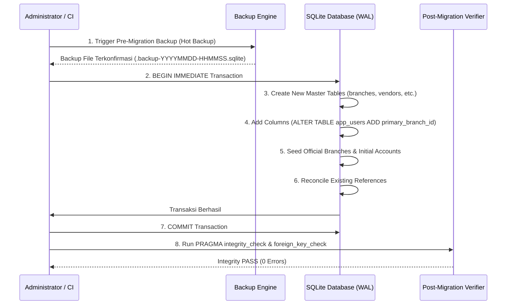

# MIGRATION & DATA RECONCILIATION PLAN — PHASE 00
**Project:** BLC Caready Procurement Pro  
**Document:** Database Migration, Reconciliation & Rollback Specification (Task DBH-006)  
**Status:** IN REVIEW — HARDENING DESIGN  
**Review Authority:** Project Manager & Product Owner  
**Date:** 10 November 2026  

---

## 1. Executive Summary

Dokumen ini merinci strategi migrasi data dan rekonsiliasi bertahap dari arsitektur penyimpanan eksisting (hibrida SQLite dan JSON `workspace`) menuju rancangan basis data v1 yang telah diperkuat.

### Prinsip Utama Migrasi:
1. **Additive & Non-Destructive:** Seluruh perubahan skema bersifat aditif (*additive*). Kolom atau tabel baru ditambahkan tanpa menghapus atau mengubah kolom eksisting.
2. **Idempotent Execution:** Skrip migrasi dapat dijalankan berulang kali tanpa menghasilkan error atau duplikasi data (*safe for repeated execution*).
3. **Zero Automated Name Guessing:** Pencocokan identitas atau relasi data tidak boleh menggunakan kesamaan nama secara otomatis. Seluruh pemetaan cabang dan vendor dilakukan melalui tabel pemetaan eksplisit.
4. **Transactional Rollback:** Setiap langkah migrasi dibungkus dalam transaksi `BEGIN IMMEDIATE ... COMMIT`. Jika terjadi kegagalan di tengah jalan, seluruh perubahan di-rollback secara otomatis tanpa meninggalkan status parsial.

---

## 2. Pemetaan Data Eksisting ke Skema Baru (Data Reconciliation)

### 2.1. Pemetaan Master Cabang Eksisting (Explicit Branch Mapping)
Sebanyak 7 nama cabang yang saat ini tercatat pada file statis [`src/domain/branches.ts`](file:///C:/Users/BLC/orca/workspaces/blc-procurement/betta/src/domain/branches.ts) dan profil pengguna `app_users.branch` dipetakan secara eksplisit ke tabel master `branches`:

| Nama Cabang Eksisting | Proposed Stable ID (`id`) | Proposed Code (`code`) | Alamat Kantor / Keterangan | Status Awal |
|---|---|---|---|:---:|
| **Bekasi** | `brc-bks` | `BKS` | Kantor Pusat & Pool Utama Bekasi | `ACTIVE` |
| **Cibinong** | `brc-cbn` | `CBN` | Kantor Cabang Cibinong | `ACTIVE` |
| **Medan** | `brc-mdn` | `MDN` | Kantor Cabang Medan | `ACTIVE` |
| **Surabaya** | `brc-sby` | `SBY` | Kantor Cabang Surabaya | `ACTIVE` |
| **Pekanbaru** | `brc-pku` | `PKU` | Kantor Cabang Pekanbaru | `ACTIVE` |
| **Makassar** | `brc-mks` | `MKS` | Kantor Cabang Makassar | `ACTIVE` |
| **Samarinda** | `brc-smd` | `SMD` | Kantor Cabang Samarinda | `ACTIVE` |

### 2.2. Rekonsiliasi Pengguna ke `primary_branch_id`:
Skrip migrasi akan mengeksekusi pembaruan relasional:
```sql
UPDATE app_users SET primary_branch_id = 'brc-bks' WHERE branch = 'Bekasi';
UPDATE app_users SET primary_branch_id = 'brc-cbn' WHERE branch = 'Cibinong';
UPDATE app_users SET primary_branch_id = 'brc-mdn' WHERE branch = 'Medan';
UPDATE app_users SET primary_branch_id = 'brc-sby' WHERE branch = 'Surabaya';
UPDATE app_users SET primary_branch_id = 'brc-pku' WHERE branch = 'Pekanbaru';
UPDATE app_users SET primary_branch_id = 'brc-mks' WHERE branch = 'Makassar';
UPDATE app_users SET primary_branch_id = 'brc-smd' WHERE branch = 'Samarinda';
```
> [!IMPORTANT]
> Jika ditemukan pengguna dengan nama cabang di luar 7 cabang resmi, skrip migrasi **TIDAK AKAN** menebak cabang pengguna tersebut, melainkan memasukkannya ke dalam tabel *Reconciliation Exception Log* untuk ditinjau secara manual oleh Administrator.

### 2.3. Rekonsiliasi Rekanan Eksisting (Vendor Extraction & Deduplication):
Saat ini data vendor tersimpan secara denormalized pada dokumen `PO` di dalam `workspace.payload`. Skrip rekonsiliasi akan:
1. Membaca seluruh `po.vendorName`, `po.vendorCode`, dan `po.bankDetails` dari dokumen PO berstatus `APPROVED`.
2. Mengekstrak daftar nama unik.
3. Mengelompokkan potensi variasi penulisan (misal: "PT Sumber Makmur" vs "PT. Sumber Makmur").
4. Menghasilkan draf data awal untuk tabel `vendors` dengan status `'DRAFT'` atau `'ACTIVE'`.
5. Mendaftarkan rekening bank terkait ke tabel `vendor_bank_accounts`.

---

## 3. Langkah-Langkah Eksekusi Migrasi (Migration Execution Steps)



### Script DDL Migrasi Idempoten Contoh:
```sql
-- migration-v3-hardening.sql
PRAGMA foreign_keys = OFF; -- Dimatikan sementara selama DDL alter, diaktifkan kembali sebelum verifikasi

BEGIN IMMEDIATE;

-- 1. Buat Tabel branches jika belum ada
CREATE TABLE IF NOT EXISTS branches (
  id TEXT PRIMARY KEY,
  code TEXT NOT NULL UNIQUE,
  name TEXT NOT NULL,
  address TEXT,
  status TEXT NOT NULL CHECK(status IN ('ACTIVE', 'INACTIVE')) DEFAULT 'ACTIVE',
  created_at TEXT NOT NULL,
  created_by TEXT NOT NULL,
  updated_at TEXT NOT NULL,
  updated_by TEXT NOT NULL
);

-- 2. Seed 7 Cabang Resmi jika kosong
INSERT OR IGNORE INTO branches (id, code, name, status, created_at, created_by, updated_at, updated_by) VALUES
  ('brc-bks', 'BKS', 'Bekasi', 'ACTIVE', datetime('now'), 'SYSTEM_BOOTSTRAP', datetime('now'), 'SYSTEM_BOOTSTRAP'),
  ('brc-cbn', 'CBN', 'Cibinong', 'ACTIVE', datetime('now'), 'SYSTEM_BOOTSTRAP', datetime('now'), 'SYSTEM_BOOTSTRAP'),
  ('brc-mdn', 'MDN', 'Medan', 'ACTIVE', datetime('now'), 'SYSTEM_BOOTSTRAP', datetime('now'), 'SYSTEM_BOOTSTRAP'),
  ('brc-sby', 'SBY', 'Surabaya', 'ACTIVE', datetime('now'), 'SYSTEM_BOOTSTRAP', datetime('now'), 'SYSTEM_BOOTSTRAP'),
  ('brc-pku', 'PKU', 'Pekanbaru', 'ACTIVE', datetime('now'), 'SYSTEM_BOOTSTRAP', datetime('now'), 'SYSTEM_BOOTSTRAP'),
  ('brc-mks', 'MKS', 'Makassar', 'ACTIVE', datetime('now'), 'SYSTEM_BOOTSTRAP', datetime('now'), 'SYSTEM_BOOTSTRAP'),
  ('brc-smd', 'SMD', 'Samarinda', 'ACTIVE', datetime('now'), 'SYSTEM_BOOTSTRAP', datetime('now'), 'SYSTEM_BOOTSTRAP');

-- 3. Tambahkan kolom primary_branch_id ke app_users (hanya jika belum ada)
-- SQLite mendukung penambahan kolom nullable dengan aman
-- (Diatur melalui pemeriksaan pragma table_info pada kode TypeScript runner)

COMMIT;

PRAGMA foreign_keys = ON;
PRAGMA foreign_key_check;
PRAGMA integrity_check;
```

---

## 4. Strategi Cadangan & Pemulihan (Backup & Rollback Strategy)

### 4.1. Prosedur Pre-Migration Backup:
Sebelum migrasi dieksekusi pada database operasional:
1. Server dihentikan sementara atau diposisikan ke dalam mode pemeliharaan (*read-only maintenance mode*).
2. Database disalin menggunakan mekanisme SQLite Vacuum / Backup API:
   ```bash
   sqlite3 .data/blc-local.sqlite ".backup '.data/backups/blc-pre-hardening-$(date +%Y%m%d%H%M%S).sqlite'"
   ```
3. Checksum SHA-256 berkas backup dihitung dan dicatat pada log deployment.

### 4.2. Prosedur Pemulihan (Rollback Procedure):
Jika proses migrasi gagal atau pengujian pasca-migrasi mendeteksi anomali integritas data:
1. Transaksi database dibatalkan (`ROLLBACK`).
2. Jika kegagalan terjadi pasca-commit:
   - Server segera dimatikan.
   - Berkas database `.data/blc-local.sqlite` digantikan kembali dengan berkas cadangan (*pre-migration backup*).
   - Log error dilaporkan kepada Project Manager dan Product Owner.
   - Status dikembalikan ke kondisi stabil sebelumnya tanpa kehilangan transaksi satu pun.
