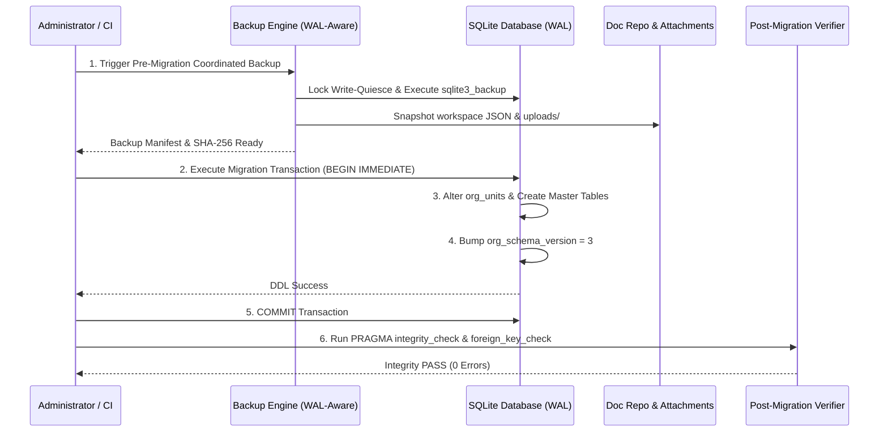

# MIGRATION & DATA RECONCILIATION PLAN — PHASE 00
## Database Migration, Reconciliation & Rollback Specification (Task DBH-006 & REC-01 s/d REC-04)

**Project:** BLC Caready Procurement Pro  
**Document:** Database Migration, Reconciliation & Rollback Specification (Task DBH-006)  
**Status:** AUTHORIZED — DOCUMENTATION REVISION ONLY  
**Reference:** BLC Procurement Guide v3, November 2026  
**Scope:** Finalisasi REG-01–REG-06, DB-REVIEW-01–03, dan Rekonsiliasi REC-01–REC-04  
**Implementation:** LOCKED  
**Production Migration:** LOCKED  
**Review Authority:** Project Manager & Product Owner  
**Date:** 10 November 2026  

---

## 1. Executive Summary

Dokumen ini merinci strategi migrasi data, rekonsiliasi bertahap, serta protokol pencadangan dan pemulihan (*backup and restore protocol*) menuju rancangan basis data v1 yang telah diperkuat. Seluruh rancangan mematuhi keputusan final Product Owner (**ADR-DB-001 s/d ADR-DB-007**, **REG-01 s/d REG-06**, **DB-REVIEW-01 s/d DB-REVIEW-03**, dan **REC-01 s/d REC-04**).

> [!IMPORTANT]
> **Status: AUTHORIZED — DOCUMENTATION REVISION ONLY.**  
> Dokumen ini berstatus spesifikasi rancangan migrasi. Seluruh eksekusi migrasi ke database operasional dihentikan (*locked*) hingga izin implementasi resmi diterbitkan oleh Product Owner.

### Prinsip Utama Migrasi:
1. **Additive & Non-Destructive:** Seluruh perubahan skema bersifat aditif (*additive*). Kolom atau tabel baru ditambahkan tanpa menghapus atau mengubah kolom eksisting.
2. **Idempotent Execution:** Skrip migrasi dirancang idempoten dan aman dijalankan berulang kali tanpa menghasilkan error atau duplikasi data.
3. **Safe Existing Table Alteration (REC-03):** Migrasi terhadap tabel yang sudah ada (`org_units`) mendeteksi skema melalui `PRAGMA table_info` dan menaikkan versi skema secara aman.
4. **Zero Automated Name Guessing:** Pencocokan identitas atau relasi organisasi wajib menggunakan identifier kanonikal pengguna yang terverifikasi (`usr-*`), bukan menebak berdasarkan nama atau jabatan (DB-REVIEW-01).
5. **Transactional Rollback:** Setiap langkah migrasi dibungkus dalam transaksi `BEGIN IMMEDIATE ... COMMIT`.
6. **Cross-Storage Coordinated Backup:** Pencadangan point-in-time konsisten mencakup database SQLite WAL, repositori dokumen transaksi, dan berkas lampiran (DB-REVIEW-03).

---

## 2. Pemetaan Data Eksisting ke Skema Baru (Data Reconciliation)

### 2.1. Pemetaan Master Cabang Eksisting (Explicit Branch Mapping)
Sebanyak 7 nama cabang yang saat ini tercatat pada file statis [`src/domain/branches.ts`](file:///C:/Users/Bernard/Documents/personal's%20project/BLC/src/domain/branches.ts) dan profil pengguna `app_users.branch` dipetakan secara eksplisit ke tabel master `branches`:

| Nama Cabang Eksisting | Proposed Stable ID (`id`) | Proposed Code (`code`) | Alamat Kantor / Keterangan | Status Awal |
|---|---|---|---|:---:|
| **Bekasi** | `brc-bks` | `BKS` | Kantor Pusat & Pool Utama Bekasi | `ACTIVE` |
| **Cibinong** | `brc-cbn` | `CBN` | Kantor Cabang Cibinong | `ACTIVE` |
| **Medan** | `brc-mdn` | `MDN` | Kantor Cabang Medan | `ACTIVE` |
| **Surabaya** | `brc-sby` | `SBY` | Kantor Cabang Surabaya | `ACTIVE` |
| **Pekanbaru** | `brc-pku` | `PKU` | Kantor Cabang Pekanbaru | `ACTIVE` |
| **Makassar** | `brc-mks` | `MKS` | Kantor Cabang Makassar | `ACTIVE` |
| **Samarinda** | `brc-smd` | `SMD` | Kantor Cabang Samarinda | `ACTIVE` |

### 2.2. Rekonsiliasi Pengguna ke `primary_branch_id`:
```sql
UPDATE app_users SET primary_branch_id = 'brc-bks' WHERE branch = 'Bekasi';
UPDATE app_users SET primary_branch_id = 'brc-cbn' WHERE branch = 'Cibinong';
UPDATE app_users SET primary_branch_id = 'brc-mdn' WHERE branch = 'Medan';
UPDATE app_users SET primary_branch_id = 'brc-sby' WHERE branch = 'Surabaya';
UPDATE app_users SET primary_branch_id = 'brc-pku' WHERE branch = 'Pekanbaru';
UPDATE app_users SET primary_branch_id = 'brc-mks' WHERE branch = 'Makassar';
UPDATE app_users SET primary_branch_id = 'brc-smd' WHERE branch = 'Samarinda';
```

---

## 3. Runbook Migrasi Aman Tabel Eksisting `org_units` (TASK REC-03)

### 3.1. Analisis Skema Eksisting:
Berdasarkan inspeksi langsung pada [`server/organization.ts#L49`](file:///C:/Users/Bernard/Documents/personal's%20project/BLC/server/organization.ts#L49), tabel `org_units` saat ini didefinisikan sebagai:
```sql
CREATE TABLE IF NOT EXISTS org_units (
  id TEXT PRIMARY KEY,
  name TEXT NOT NULL UNIQUE,
  created_at TEXT NOT NULL,
  created_by TEXT NOT NULL
);
```
Tabel versi saat ini dipantau oleh fungsi `schemaState()` yang membaca tabel `org_schema_version` (versi 2). Perintah `CREATE TABLE IF NOT EXISTS` tidak berpengaruh terhadap tabel yang sudah ada, sehingga penambahan kolom `code`, `branch_id`, `status`, `updated_at`, dan `updated_by` wajib melalui prosedur migrasi aditif terstruktur.

### 3.2. Prosedur Migrasi Aditif Berkelanjutan (Phase DB-02):
Skrip migrasi dijalankan melalui TypeScript migration runner yang mematuhi 9 tahapan integritas:

```typescript
// Proposed Migration Step: DB-02 Safe org_units Alteration
export function migrateOrgUnitsToV3(db: DatabaseSync): void {
  // 1. Periksa versi skema saat ini
  const versionRow = db.prepare('SELECT version FROM org_schema_version LIMIT 1').get() as { version: number } | undefined;
  if (!versionRow || versionRow.version < 2) {
    throw new Error('Database harus berada pada skema organisasi minimal versi 2 sebelum migrasi ke versi 3.');
  }
  if (versionRow.version >= 3) {
    return; // Idempotent: sudah termigrasi
  }

  // 2. Bungkus dalam transaksi IMMEDIATE
  db.exec('PRAGMA foreign_keys=OFF; BEGIN IMMEDIATE;');
  try {
    // 3. Inspeksi kolom eksisting pada org_units
    const columns = db.prepare("PRAGMA table_info('org_units')").all() as { name: string }[];
    const colNames = new Set(columns.map(c => c.name));

    // 4. Tambahkan kolom aditif yang belum ada
    if (!colNames.has('code')) {
      db.exec('ALTER TABLE org_units ADD COLUMN code TEXT;');
    }
    if (!colNames.has('branch_id')) {
      db.exec('ALTER TABLE org_units ADD COLUMN branch_id TEXT REFERENCES branches(id);');
    }
    if (!colNames.has('status')) {
      db.exec("ALTER TABLE org_units ADD COLUMN status TEXT NOT NULL DEFAULT 'ACTIVE' CHECK(status IN ('ACTIVE','INACTIVE'));");
    }
    if (!colNames.has('updated_at')) {
      db.exec('ALTER TABLE org_units ADD COLUMN updated_at TEXT;');
    }
    if (!colNames.has('updated_by')) {
      db.exec('ALTER TABLE org_units ADD COLUMN updated_by TEXT;');
    }

    // 5. Buat partial unique index untuk kode unit
    db.exec('CREATE UNIQUE INDEX IF NOT EXISTS idx_org_units_code ON org_units(code) WHERE code IS NOT NULL;');
    db.exec('CREATE INDEX IF NOT EXISTS idx_org_units_branch ON org_units(branch_id);');
    db.exec('CREATE INDEX IF NOT EXISTS idx_org_units_status ON org_units(status);');

    // 6. Rekonsiliasi data unit datar eksisting dengan cabang default
    const now = new Date().toISOString();
    db.prepare(`
      UPDATE org_units 
      SET status = 'ACTIVE', updated_at = ?, updated_by = 'MIGRATION_V3' 
      WHERE status IS NULL OR updated_at IS NULL
    `).run(now);

    // 7. Naikkan versi skema ke versi 3
    db.exec('DROP TABLE IF EXISTS org_schema_version;');
    db.exec('CREATE TABLE org_schema_version (version INTEGER NOT NULL CHECK(version=3));');
    db.prepare('INSERT INTO org_schema_version(version) VALUES(3);').run();

    // 8. Commit transaksi
    db.exec('COMMIT;');
  } catch (err) {
    db.exec('ROLLBACK;');
    throw err;
  } finally {
    db.exec('PRAGMA foreign_keys=ON;');
    // 9. Verifikasi integritas pasca migrasi
    const fkCheck = db.prepare('PRAGMA foreign_key_check;').all();
    if (fkCheck.length > 0) {
      throw new Error(`Integritas Foreign Key terlanggar pasca migrasi org_units: ${JSON.stringify(fkCheck)}`);
    }
  }
}
```

---

## 4. Rekonsiliasi Dokumen & Pembayaran Bertahap (REC-01 & REC-02)

### 4.1. Rekonsiliasi Dokumen RC (Realisasi Kasbon REC-01):
- Dokumen `RC` yang telah tercatat pada dokumen historis dipertahankan secara utuh.
- Validasi kardinalitas 1 AV : 1 RC tetap ditegakkan pada submission ([`server/repository.ts#L424-L445`](file:///C:/Users/Bernard/Documents/personal's%20project/BLC/server/repository.ts#L424-L445)).
- Dokumen `RC` dengan status `DEFICIT` tetap menjadi sumber sah bagi penerbitan satu PV selisih (`sourceDocType = 'RC_DEFICIT'`).

### 4.2. Rekonsiliasi Pembayaran Bertahap PO (REC-02):
- Untuk PO historis yang memiliki lebih dari satu PV atau pembayaran uang muka (`AV` bertaut `parentPoId`), skrip audit menghitung akumulasi komitmen:
  ```typescript
  const committed = getCommittedAmountOnPo(po.id);
  const remaining = po.totalAmount - committed;
  ```
- Dokumen PO dengan `remaining === 0` dipastikan berstatus pembayaran `PAID`.
- Dokumen PO dengan `committed > 0` dan `remaining > 0` dipastikan berstatus pembayaran `PARTIALLY_PAID`.

---

## 5. Strategi Cadangan & Pemulihan (Backup & Recovery Protocol — DB-REVIEW-03)

### 5.1. Alur Koordinasi Cadangan Point-in-Time:


### 5.2. Verifikasi Pemulihan (Verified Restore Protocol):
- Berkas cadangan SQLite hasil pemulihan wajib lolos uji `PRAGMA integrity_check;` (`ok`) dan `PRAGMA foreign_key_check;` (0 baris).
- Simulasi pemulihan (*restore rehearsal*) dijalankan secara berkala pada direktori pengujian terisolasi untuk membuktikan dokumen dan state alur approval dapat dibaca 100% tanpa inkonsistensi data.
