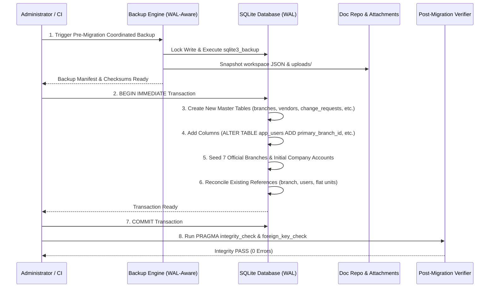

# MIGRATION & DATA RECONCILIATION PLAN — PHASE 00
## Database Migration, Reconciliation & Rollback Specification (Task DBH-006)

**Project:** BLC Caready Procurement Pro  
**Document:** Database Migration, Reconciliation & Rollback Specification (Task DBH-006)  
**Status:** DESIGN FINALIZED — AWAITING IMPLEMENTATION APPROVAL  
**Scope:** Finalisasi REG-01–REG-06 dan DB-REVIEW-01–03  
**Implementation:** NOT AUTHORIZED  
**Production Migration:** LOCKED  
**Review Authority:** Project Manager & Product Owner  
**Date:** 10 November 2026  

---

## 1. Executive Summary

Dokumen ini merinci strategi migrasi data, rekonsiliasi bertahap, serta protokol pencadangan dan pemulihan (*backup and restore protocol*) menuju rancangan basis data v1 yang telah diperkuat. Seluruh rancangan mematuhi keputusan final Product Owner (**ADR-DB-001 s/d ADR-DB-007**, **REG-01 s/d REG-06**, dan **DB-REVIEW-01 s/d DB-REVIEW-03**).

> [!IMPORTANT]
> **Status: DESIGN FINALIZED — IMPLEMENTATION NOT AUTHORIZED.**  
> Dokumen ini berstatus spesifikasi rancangan migrasi. Seluruh eksekusi migrasi ke database operasional dihentikan (*locked*) hingga izin implementasi resmi diterbitkan oleh Product Owner.

### Prinsip Utama Migrasi:
1. **Additive & Non-Destructive:** Seluruh perubahan skema bersifat aditif (*additive*). Kolom atau tabel baru ditambahkan tanpa menghapus atau mengubah kolom eksisting.
2. **Idempotent Execution:** Skrip migrasi dirancang idempoten dan aman dijalankan berulang kali tanpa menghasilkan error atau duplikasi data.
3. **Zero Automated Name Guessing:** Pencocokan identitas atau relasi organisasi wajib menggunakan identifier kanonikal pengguna yang terverifikasi, bukan menebak berdasarkan kesamaan nama atau jabatan (DB-REVIEW-01).
4. **Transactional Rollback:** Setiap langkah migrasi dibungkus dalam transaksi `BEGIN IMMEDIATE ... COMMIT`.
5. **Cross-Storage Coordinated Backup:** Pencadangan point-in-time konsisten mencakup database SQLite WAL, repositori dokumen transaksi, dan berkas lampiran (DB-REVIEW-03).

---

## 2. Pemetaan Data Eksisting ke Skema Baru (Data Reconciliation)

### 2.1. Pemetaan Master Cabang Eksisting (Explicit Branch Mapping)
Sebanyak 7 nama cabang yang saat ini tercatat pada file statis [`src/domain/branches.ts`](file:///C:/Users/Bernard/Documents/personal's%20project/BLC/src/domain/branches.ts) dan profil pengguna `app_users.branch` dipetakan secara eksplisit ke tabel master `branches`:

| Nama Cabang Eksisting | Proposed Stable ID (`id`) | Proposed Code (`code`) | Alamat Kantor / Keterangan | Status Awal |
|---|---|---|---|:---:|
| **Bekasi** | `brc-bks` | `BKS` | Kantor Pusat & Pool Utama Bekasi | `ACTIVE` |
| **Cibinong** | `brc-cbn` | `CBN` | Kantor Cabang Cibinong | `ACTIVE` |
| **Medan** | `brc-mdn` | `MDN` | Kantor Cabang Medan | `ACTIVE` |
| **Surabaya** | `brc-sby` | `SBY` | Kantor Cabang Surabaya | `ACTIVE` |
| **Pekanbaru** | `brc-pku` | `PKU` | Kantor Cabang Pekanbaru | `ACTIVE` |
| **Makassar** | `brc-mks` | `MKS` | Kantor Cabang Makassar | `ACTIVE` |
| **Samarinda** | `brc-smd` | `SMD` | Kantor Cabang Samarinda | `ACTIVE` |

### 2.2. Rekonsiliasi Pengguna ke `primary_branch_id`:
Skrip migrasi akan mengeksekusi pembaruan relasional:
```sql
UPDATE app_users SET primary_branch_id = 'brc-bks' WHERE branch = 'Bekasi';
UPDATE app_users SET primary_branch_id = 'brc-cbn' WHERE branch = 'Cibinong';
UPDATE app_users SET primary_branch_id = 'brc-mdn' WHERE branch = 'Medan';
UPDATE app_users SET primary_branch_id = 'brc-sby' WHERE branch = 'Surabaya';
UPDATE app_users SET primary_branch_id = 'brc-pku' WHERE branch = 'Pekanbaru';
UPDATE app_users SET primary_branch_id = 'brc-mks' WHERE branch = 'Makassar';
UPDATE app_users SET primary_branch_id = 'brc-smd' WHERE branch = 'Samarinda';
```
> [!IMPORTANT]
> Jika ditemukan pengguna dengan nama cabang di luar 7 cabang resmi, skrip migrasi **TIDAK AKAN** menebak cabang pengguna tersebut, melainkan memasukkannya ke dalam tabel *Reconciliation Exception Log* untuk ditinjau secara manual oleh Administrator.

### 2.3. Rekonsiliasi Struktur Organisasi Resmi (Official Organization Reference — DB-REVIEW-01):
- **Referensi Resmi:** Menggunakan worksheet `Organization_BLC` pada workbook operasional resmi sebagai sumber kebenaran (*single source of truth*) data divisi dan posisi.
- **Unit Datar (Flat Units):** Unit organisasi dipetakan sebagai flat units dengan penanda cabang (`branch_id`) dan status aktif (REG-04).
- **Identifier Verifikasi:** Pencocokan pengguna dengan jabatan dan unit organisasi dilakukan berdasarkan identifier kanonikal pengguna (`usr-*`) yang telah diverifikasi (`verification_status = 'VERIFIED'`). Tidak diperkenankan melakukan pencocokan atau penugasan otomatis hanya berdasarkan string nama dan jabatan.
- **Kekebalan Approval Historis:** Rekonsiliasi unit dan cabang baru tidak mengubah data snapshot approval yang telah terkunci pada dokumen historis.

### 2.4. Rekonsiliasi Rekanan Eksisting (Vendor Extraction & Deduplication):
1. Membaca seluruh `po.vendorName`, `po.vendorCode`, dan `po.bankDetails` dari dokumen PO berstatus `APPROVED`.
2. Mengekstrak daftar nama unik dan menormalisasi penamaan.
3. Mendaftarkan draf data awal untuk tabel `vendors` dengan status `'ACTIVE'` atau `'DRAFT'`.
4. Mendaftarkan rekening bank terkait ke tabel `vendor_bank_accounts`.
5. Perubahan rekening di masa mendatang dialihkan ke alur Maker–Checker (`vendor_bank_account_change_requests`) sesuai REG-02.

---

## 3. Langkah-Langkah Eksekusi Migrasi (Migration Execution Steps)



---

## 4. Strategi Cadangan & Pemulihan (Backup & Recovery Protocol — DB-REVIEW-03)

### 4.1. Tantangan Arsitektur SQLite WAL & Multi-Storage:
Karena sistem menggunakan SQLite dalam mode Write-Ahead Logging (WAL) dan dokumen transaksi disimpan secara hibrida pada JSON `workspace` serta lampiran fisik di `.data/uploads/`:
- **Menyalin file `.sqlite` secara langsung saat server aktif dilarang keras** karena dapat menghasilkan berkas yang korup atau terfragmentasi.
- **Backup SQLite saja tidak cukup** untuk memulihkan seluruh sistem jika data transaksi JSON atau berkas lampiran tidak dicadangkan pada titik waktu (*point-in-time*) yang persis sama.
- Sistem **tidak mengklaim pencadangan atomik lintas storage tanpa koordinasi yang teruji**.

### 4.2. Spesifikasi Pencadangan Konsisten (Consistent Backup Requirements):
1. **SQLite Online Backup API:** Menggunakan utility `.backup` SQLite atau binding `sqlite3_backup_*` yang menjamin snapshot konsisten tanpa menghentikan pembacaan.
2. **Metadata Versi Skema:** Menyertakan informasi nomor commit git, versi migrasi, dan waktu pembuatan.
3. **Manifest & Checksum:** Setiap arsip cadangan menghasilkan file manifest yang memuat hash SHA-256 berkas database, berkas workspace dokumen, dan daftar attachment.
4. **Koordinasi Multi-Storage:**
   - Langkah 1: Kunci sementara transaksi penulisan baru (*write-quiesce*).
   - Langkah 2: Jalankan backup database SQLite ke folder cadangan:
     ```bash
     sqlite3 .data/blc-local.sqlite ".backup '.data/backups/blc-db-$(date +%Y%m%d%H%M%S).sqlite'"
     ```
   - Langkah 3: Salin snapshot `workspace` dan direktori `.data/uploads/`.
   - Langkah 4: Buka kembali kunci penulisan.
   - Langkah 5: Hitung dan catat checksum SHA-256 ke dalam manifest.

### 4.3. Prosedur Verifikasi Pemulihan (Verified Restore Protocol):
Sebelum hasil cadangan dinyatakan layak (*recovery readiness*), protokol pengujian berikut wajib dijalankan pada lingkungan terisolasi (*restore rehearsal*):
1. **Struktur B-Tree:** Menjalankan `PRAGMA integrity_check;` pada database hasil pemulihan (wajib mengembalikan `ok`).
2. **Integritas Relasional:** Menjalankan `PRAGMA foreign_key_check;` (wajib 0 baris pelanggaran).
3. **Validasi Transaksi & Approval:** Memverifikasi dokumen historis dan stage approval dapat dibaca secara utuh tanpa referensi yatim (*orphans*).
4. **Dokumentasi RTO/RPO:** Menetapkan batas waktu pemulihan (*Recovery Time Objective*) dan potensi kehilangan data (*Recovery Point Objective*) berdasarkan mekanisme yang benar-benar tersedia dan teruji di server lokal.
