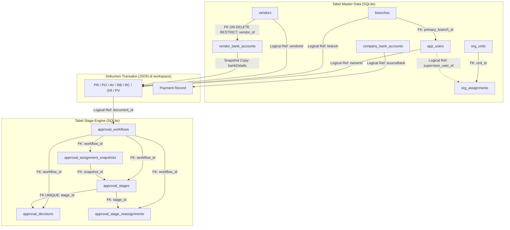

# RELATIONAL INTEGRITY & DATABASE CONSTRAINTS REVIEW — PHASE 00
**Project:** BLC Caready Procurement Pro  
**Document:** Relational Integrity & Invariant Specification (Task DBH-003)  
**Status:** IN REVIEW — HARDENING DESIGN  
**Review Authority:** Project Manager & Product Owner  
**Date:** 10 November 2026  

---

## 1. Executive Summary

Dokumen ini merumuskan penegakan integritas relasional (*relational integrity*) dan batasan database (*database constraints*) untuk sistem BLC Caready Procurement Pro. Penegakan integritas dibagi menjadi dua lapis pertahanan (*defense-in-depth*):
1. **Physical Engine Layer (SQLite Constraints):** Ditegakkan secara fisik oleh mesin database SQLite melalui Foreign Keys, Check Constraints, Unique Indexes, dan Not-Null Constraints.
2. **Application Domain Layer (Domain Invariants):** Ditegakkan secara transaksional di dalam kode backend ([`server/repository.ts`](file:///C:/Users/BLC/orca/workspaces/blc-procurement/betta/server/repository.ts), [`server/stage-engine.ts`](file:///C:/Users/BLC/orca/workspaces/blc-procurement/betta/server/stage-engine.ts), [`server/organization.ts`](file:///C:/Users/BLC/orca/workspaces/blc-procurement/betta/server/organization.ts)) untuk memvalidasi aturan bisnis kompleks sebelum data ditulis ke disk.

---

## 2. Invarian Wajib Sistem (Mandatory Invariants)

Berikut adalah sembilan (9) invarian wajib yang tidak boleh dilanggar dalam kondisi apapun:

| No | Nama Invarian | Deskripsi Aturan Bisnis | Mekanisme Penegakan | Status |
|:---:|---|---|---|:---:|
| 1 | **User Primary Branch Invariant** | Setiap pengguna aktif wajib merujuk ke cabang yang valid pada master cabang. | FK `app_users.primary_branch_id REFERENCES branches(id)` + validasi status cabang `ACTIVE` saat penugasan. | **Dirancang** |
| 2 | **Single Primary Role Invariant** | Setiap pengguna memiliki tepat satu *primary application role*. Hak akses approval tidak diberikan otomatis oleh role ini. | Kolom `app_users.role` tunggal dengan validasi enum ketat + approval dipisahkan ke stage engine. | **Terpenuhi** |
| 3 | **Valid Approver Assignment Invariant** | Penugasan supervisor pada divisi wajib merujuk ke pengguna yang sah dan berstatus `ACTIVE` serta `VERIFIED`. | Validasi `eligible()` pada `OrganizationRepository` + FK `org_assignments(unit_id, supervisor_user_id)`. | **Terpenuhi** |
| 4 | **Non-Eligible Approver Invariant** | Pengguna yang berstatus `INACTIVE` atau `UNVERIFIED` tidak boleh terdaftar sebagai kandidat approver aktif. | Dicegah oleh method `eligible(unitId)` dan `assertApproverCanAct()` dengan error HTTP 422. | **Terpenuhi** |
| 5 | **Valid Stage Decision Invariant** | Setiap keputusan persetujuan wajib merujuk ke tahapan (`stage_id`) yang berstatus `PENDING` dan assigned to aktor terkait. | FK `approval_decisions.stage_id REFERENCES approval_stages(id)` + unique index 1 keputusan per stage. | **Terpenuhi** |
| 6 | **Vendor Bank Relationship Invariant** | Rekening bank vendor wajib merujuk ke entitas vendor yang terdaftar dan berstatus aktif. | FK `vendor_bank_accounts.vendor_id REFERENCES vendors(id) ON DELETE RESTRICT`. | **Dirancang** |
| 7 | **Active Company Account Invariant** | Pencatatan pembayaran PV hanya boleh memilih rekening kas BLC yang aktif pada `company_bank_accounts`. | Validasi status `ACTIVE` pada endpoint `POST /api/v1/payments/:pvId/record`. | **Dirancang** |
| 8 | **Approval Snapshot Immutability Invariant**| Data approver yang dikunci saat draf disubmit (`approval_assignment_snapshots`) tidak boleh berubah akibat mutasi master data. | Tabel snapshot terpisah yang diisi sekali saat submission; tidak ada trigger update retrospektif. | **Terpenuhi** |
| 9 | **Zero Orphan Reference Invariant** | Penonaktifan master data (cabang, vendor, rekening) tidak boleh menghapus baris data secara fisik jika sudah pernah dirujuk. | Kebijakan *Soft Deactivation* (`status = 'INACTIVE'`) dan larangan hard `DELETE`. | **Dirancang** |

---

## 3. Matriks Integritas Relasional Antar-Tabel



### Aksi Referensial (Referential Actions):
- **Semua Relasi Master Data:** Diterapkan `ON DELETE RESTRICT` (atau default SQLite `RESTRICT`). Tidak diperbolehkan menggunakan `ON DELETE CASCADE` pada entitas master maupun transaksi, untuk mencegah penghapusan data berantai yang tidak disengaja.

---

## 4. Analisis Strategi Pengindeksan (Indexing Strategy)

Indeks hanya ditambahkan untuk mendukung pola query aktual (*read access patterns*) guna menghindari overhead penulisan (*write amplification*):

| Indeks Fisik | Target Tabel & Kolom | Pola Query yang Dioptimalkan | Jenis Indeks |
|---|---|---|:---:|
| `idx_branches_code_unique` | `branches(code)` | Pencarian cepat dan validasi keunikan kode cabang saat registrasi/update. | UNIQUE |
| `idx_branches_status` | `branches(status)` | Filtering dropdown cabang aktif pada antarmuka pengguna (`WHERE status='ACTIVE'`). | Regular |
| `idx_vendors_code` | `vendors(vendor_code)` | Pencarian vendor berdasarkan kode pada form PO. | UNIQUE |
| `idx_vendors_legal_name` | `vendors(legal_name)` | Autocomplete pencarian nama rekanan pada form procurement. | Regular |
| `idx_vba_account_unique` | `vendor_bank_accounts(vendor_id, bank_name, account_number)` | Mencegah pendaftaran nomor rekening yang sama lebih dari satu kali untuk vendor yang sama. | Composite UNIQUE |
| `idx_cba_code_unique` | `company_bank_accounts(account_code)` | Lookup kode unik rekening kas perusahaan saat pelunasan PV. | UNIQUE |
| `idx_decisions_stage_unique` | `approval_decisions(stage_id)` | Menjamin aturan satu tahapan hanya memiliki tepat satu keputusan final. | UNIQUE |
| `org_assignment_active_unique` | `org_assignments(unit_id, supervisor_user_id) WHERE active=1` | Mencegah penugasan aktif ganda untuk pasangan unit dan supervisor yang sama. | Partial UNIQUE |
| `idx_idempotency_lookup` | `approval_idempotency_records(...)` | Fast lookup kunci idempotensi pada pemanggilan berulang. | Composite |

---

## 5. Konfigurasi Mesin SQLite Enterprise

Untuk menjamin keandalan data setara database enterprise, file koneksi SQLite wajib mengaktifkan pragma konfigurasi berikut pada setiap inisialisasi:

```typescript
// Konfigurasi Standar Engine SQLite BLC Procurement Pro
export function configureSqliteEngine(db: DatabaseSync): void {
  // 1. Wajib aktifkan Foreign Key Enforcement
  db.exec('PRAGMA foreign_keys = ON;');

  // 2. Aktifkan Write-Ahead Logging (WAL) untuk konkurensi pembacaan & penulisan
  db.exec('PRAGMA journal_mode = WAL;');

  // 3. Sinkronisasi aman yang seimbang dengan performa
  db.exec('PRAGMA synchronous = NORMAL;');

  // 4. Timeout tunggu penguncian basis data (5 detik) untuk mencegah 'database is locked'
  db.exec('PRAGMA busy_timeout = 5000;');

  // 5. Penggunaan memori sementara untuk indexing dan sorting
  db.exec('PRAGMA temp_store = MEMORY;');
}
```

### Prosedur Pemeriksaan Integritas Otomatis:
Pada proses *health check* dan saat migrasi skema dijalankan, server mengeksekusi dua perintah verifikasi integritas:
1. `PRAGMA integrity_check;` — Memastikan berkas biner SQLite tidak mengalami kerusakan struktur B-Tree.
2. `PRAGMA foreign_key_check;` — Memastikan tidak ada data yatim (*orphaned foreign key references*) yang melanggar batasan relasional.
