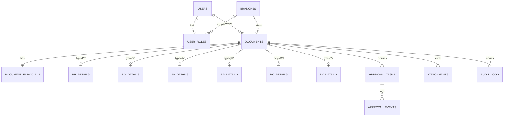

# BLC Procurement Production Roadmap, Architecture & Tasklist

> **For agentic workers:** REQUIRED SUB-SKILL: Use superpowers:subagent-driven-development (recommended) or superpowers:executing-plans to implement this plan task-by-task. Steps use checkbox (`- [ ]`) syntax for tracking.

**Goal:** Transform the BLC Caready Procurement prototype (`localStorage` SPA) into a production-grade, multi-user enterprise system with a PostgreSQL transactional database, Fastify + TypeScript modular backend, Microsoft 365 (Entra ID) authentication, private attachment storage, and a de-bloated, high-performance React UI.

**Architecture:** Modular Monolith (`apps/web` React SPA + `apps/api` Fastify REST API + `packages/shared` Zod schemas & financial calculation core + PostgreSQL 16 + Transactional Outbox Worker).

**Tech Stack:**
- **Frontend:** React 19, TypeScript, Vite, Tailwind CSS + CSS Custom Properties (`src/style.css`), TanStack Query (server state & optimistic updates), Zod + React Hook Form.
- **Backend:** Node.js 22 LTS, Fastify 5, TypeScript, Drizzle ORM (or Prisma) with explicit SQL migrations, `@fastify/jwt` / Microsoft Entra ID OIDC (`@azure/msal-node`).
- **Database:** PostgreSQL 16 (`BIGINT` minor units / `NUMERIC(18,0)` for IDR, optimistic concurrency `version`, partial unique indexes for `1 AV : 1 active RC`, append-only audit & outbox tables).
- **Storage & Background Jobs:** S3-compatible private bucket / SharePoint Graph API via backend pre-signed/proxied streams; PostgreSQL-backed `outbox_jobs` worker (`FOR UPDATE SKIP LOCKED`) for email notifications & server-side PDF voucher generation.

---

## 1. Rancangan Database Production (PostgreSQL Schema & Integrity)

Saat ini prototipe menyimpan seluruh dokumen sebagai satu blob JSON di `localStorage` (`blc_Typed_documents_v2`). Di production, data dipecah menjadi tabel relasional ternormalisasi dengan penegakan integritas di level database:

### A. Skema Tabel Utama & Cara Penerapannya

1. **Identitas, Cabang & Hak Akses (`users`, `branches`, `user_roles`)**
   - `users`: `id (UUID PK)`, `entra_oid (VARCHAR UNIQUE)`, `email`, `full_name`, `is_active`, `created_at`.
   - `branches`: `id (UUID PK)`, `code (VARCHAR UNIQUE: 'PUSAT', 'BDG', 'SBY')`, `name`.
   - `user_roles`: `user_id (FK)`, `role ('PEMOHON' | 'ATASAN' | 'AYU' | 'BOD_HERY' | 'BOD_HASHIMOTO' | 'KEUANGAN' | 'ADMIN')`, `branch_id (FK nullable untuk global role seperti Ayu/BoD/Keuangan)`.
   - *Penerapan:* Menggantikan `RoleSwitcher` di production. Saat login via Microsoft 365, backend memuat daftar `user_roles` aktif milik akun tersebut dan membatasi query berdasarkan `branch_id`.

2. **Header Dokumen & Optimistic Locking (`documents`)**
   - `id (UUID PK)`, `doc_number (VARCHAR UNIQUE)`, `doc_type ('PR'|'PO'|'AV'|'RB'|'RC'|'PV')`, `title`, `purpose`, `branch_id (FK)`, `applicant_id (FK)`, `status ('DRAFT'|'SUBMITTED'|'IN_REVIEW'|'APPROVED'|'REJECTED'|'PAID')`, `current_stage ('DRAFT'|'ATASAN'|'AYU'|'BOD'|'FINANCE_PV'|'COMPLETED'|'REJECTED')`, `version (INT NOT NULL DEFAULT 1)`, `submitted_at`, `created_at`, `updated_at`.
   - **Penomoran Dokumen Bebas Bentrok (`doc_sequences`):** Tabel counter `(doc_type, year_month, last_seq)` yang diakses dengan `INSERT ... ON CONFLICT DO UPDATE RETURNING last_seq` di dalam transaksi saat dokumen dibuat/diajukan, menghasilkan format `PR-202611-0042` yang aman dari *race condition*.

3. **Nilai Moneter Presisi Tinggi (`document_financials`)**
   - `document_id (UUID PK/FK)`, `currency (CHAR(3) DEFAULT 'IDR')`, `subtotal (BIGINT)`, `other_costs (BIGINT)`, `discount (BIGINT)`, `ppn_rate (NUMERIC(5,4))`, `ppn_amount (BIGINT)`, `pph_rate (NUMERIC(5,4))`, `pph_amount (BIGINT)`, `total_amount (BIGINT)`, `net_payable (BIGINT)`.
   - *Penerapan:* Semua angka disimpan sebagai `BIGINT` Rupiah penuh (tanpa floating point IEEE-754) dan dihitung ulang di server menggunakan modul `src/domain/calculations.ts` sebelum disimpan.

4. **Tabel Spesifik per Modul & Kardinalitas Ketat (`pr_details`, `po_details`, `av_details`, `rb_details`, `rc_details`, `pv_details`)**
   - `pr_details`: `document_id`, `budget_type ('OPEX'|'CAPEX'|'PROJECT')`, `required_date`, `is_iam_required (BOOLEAN GENERATED ALWAYS AS (subtotal >= 5000000))`.
   - `po_details`: `document_id`, `parent_pr_id (FK -> documents.id)`, `vendor_name`, `po_category`, `payment_method`, `bank_name`, `account_number_encrypted`, `account_holder`.
   - `rc_details`: `document_id`, `parent_av_id (FK -> documents.id)`, `approved_av_amount (BIGINT)`, `realized_amount (BIGINT)`, `variance_amount (BIGINT)`, `outcome_type ('REFUND'|'DEFICIT'|'EXACT')`.
     - **Constraint Kardinalitas `1 AV : 1 RC`:** Menggunakan *Partial Unique Index* di PostgreSQL:
       `CREATE UNIQUE INDEX idx_unique_active_rc_per_av ON rc_details (parent_av_id) WHERE status_not_cancelled;` sehingga dua tab browser yang menekan Submit bersamaan tidak pernah bisa membuat 2 RC untuk 1 AV.
   - `pv_details`: `document_id`, `source_doc_id (FK UNIQUE -> documents.id)`, `payment_status ('UNPAID'|'PAID')`, `paid_at`, `payment_reference`, `paid_by_id (FK)`.

5. **Mesin Persetujuan Berjenjang & Paralel (`approval_tasks` & `approval_events`)**
   - `approval_tasks`: `id (UUID PK)`, `document_id (FK)`, `stage ('ATASAN'|'AYU'|'BOD')`, `assignee_role ('ATASAN'|'AYU'|'BOD_HERY'|'BOD_HASHIMOTO')`, `assignee_user_id (FK nullable)`, `status ('WAITING'|'PENDING'|'APPROVED'|'REJECTED'|'RESET')`, `decided_by_id (FK)`, `decided_at`, `comment`, `version (INT)`.
   - *Penerapan Alur 3 Tahap & Paralel BoD:*
     - Saat dokumen di-`submit`, transaksi database otomatis membuat 4 baris di `approval_tasks`:
       1. `stage='ATASAN'`, `status='PENDING'`
       2. `stage='AYU'`, `status='WAITING'`
       3. `stage='BOD'`, `assignee_role='BOD_HERY'`, `status='WAITING'`
       4. `stage='BOD'`, `assignee_role='BOD_HASHIMOTO'`, `status='WAITING'`
     - Saat `ATASAN` menyetujui $\rightarrow$ baris `AYU` berubah menjadi `PENDING`.
     - Saat `AYU` menyetujui $\rightarrow$ kedua baris `BOD_HERY` dan `BOD_HASHIMOTO` berubah menjadi `PENDING` secara bersamaan (paralel).
     - Dokumen baru berubah menjadi `APPROVED` jika **kedua** baris `BOD_HERY` dan `BOD_HASHIMOTO` berstatus `APPROVED` (dicek di dalam transaksi dengan `SELECT ... FOR UPDATE` pada `documents`).
     - Jika salah satu menolak (`REJECT`), dokumen kembali ke `REJECTED` (dapat diedit ulang oleh Pemohon) dan seluruh `approval_tasks` di-reset dengan riwayat sebelumnya tetap tersimpan abadi di `approval_events`.

6. **Lampiran Dokumen & Outbox (`attachments`, `audit_logs`, `outbox_jobs`)**
   - `attachments`: Menyimpan metadata file (`storage_key`, `original_name`, `mime_type`, `byte_size`, `sha256_hash`, `category: 'IAM_MEMO' | 'INVOICE' | 'QUOTATION' | 'RECEIPT' | 'PAYMENT_PROOF'`, `uploaded_by`).
   - `audit_logs`: Tabel *append-only* (tanpa izin `UPDATE`/`DELETE` bagi role aplikasi) yang mencatat setiap transisi state beserta `actor_id`, `ip_address`, `old_version`, `new_version`, dan `comment`.
   - `outbox_jobs`: Menyimpan antrean pengiriman email notifikasi (ke Atasan/Ayu/BoD/Pemohon) dan pembuatan PDF resmi dalam transaksi database yang sama dengan perubahan status dokumen.

---

## 2. Rancangan Backend & Arsitektur API (Fastify + TypeScript)

### A. Struktur Monorepo / Paket Kode
Memisahkan *shared domain logic* agar rumus finansial dan skema validasi tidak pernah ditulis dua kali di frontend dan backend:
- `packages/shared/`:
  - `calculations.ts` (pindahan langsung dari `src/domain/calculations.ts` yang sudah teruji unit test).
  - `schemas.ts` (skema Zod untuk validasi payload PR, PO, AV, RB, RC, PV).
- `apps/api/` (Fastify Server):
  - `plugins/auth.ts`: Verifikasi token JWT Microsoft Entra ID + *decorator* `request.currentUser` & `requireRole()`.
  - `modules/documents/`: Endpoint CRUD draf, submit, pencarian berpaginasi (cursor/offset), dan detail dokumen.
  - `modules/approvals/`: Endpoint keputusan berjenjang & paralel BoD dengan *idempotency key* dan *optimistic locking*.
  - `modules/payments/`: Endpoint antrean `Menunggu PV`, pembuatan PV otomatis dari PO/AV/RB/RC(Defisit), dan pencatatan pelunasan.
  - `modules/attachments/`: Upload multipart tervalidasi (batas ukuran 10MB, hanya PDF/PNG/JPG, cek wajib lampiran Memo IAM jika PR $\ge$ Rp 5.000.000) dan download via *short-lived signed URL* / stream terotorisasi.
  - `workers/outbox-worker.ts`: Worker background yang membaca `outbox_jobs` untuk mengirim email Microsoft Graph / SMTP dan merender PDF Payment Voucher.

### B. Kontrak Endpoint REST API (`/api/v1`)

| Method & Path | Otorisasi Peran | Penerapan & Aturan Bisnis Server |
|---|---|---|
| `GET /api/v1/me` | Semua User Login | Mengembalikan profil Entra ID, daftar peran aktif, dan cabang yang diizinkan. |
| `GET /api/v1/dashboard/metrics` | Semua User Login | Query agregasi SQL cepat (`SUM`, `COUNT FILTER`) untuk kartu Bento, grafik modul, dan 10 log audit terakhir sesuai cakupan cabang user. |
| `GET /api/v1/documents` | Semua User Login | Filter berdasarkan `docType`, `branch`, `status`, `search`, dan `pendingForMe=true` dengan pagination. |
| `POST /api/v1/documents/:type` | `PEMOHON` | Membuat draf baru, menghitung ulang pajak/total/varians di server, menyimpan ke DB dalam 1 transaksi. |
| `PUT /api/v1/documents/:id` | `PEMOHON` (Pemilik) | Mengubah draf (hanya diizinkan bila `status IN ('DRAFT', 'REJECTED')` dan `version` cocok). |
| `POST /api/v1/documents/:id/submit` | `PEMOHON` (Pemilik) | Memvalidasi kelengkapan field wajib & lampiran (misal Memo IAM jika PR $\ge$ Rp 5 Juta), mengunci draf menjadi `SUBMITTED`, membangkitkan `approval_tasks`, dan menulis `outbox_jobs`. |
| `POST /api/v1/documents/:id/decisions` | `ATASAN`, `AYU`, `BOD_HERY`, `BOD_HASHIMOTO` | Menerima `{ action: 'APPROVE' \| 'REJECT', comment, expectedVersion }` + header `Idempotency-Key`. Mengeksekusi transisi tahap secara atomik. Wajib mengisi `comment` saat `REJECT`. |
| `POST /api/v1/documents/:id/generate-pv` | `KEUANGAN` | Memvalidasi dokumen induk berstatus `APPROVED` (dan untuk RC harus `DEFICIT`), belum memiliki PV, lalu membuat dokumen PV otomatis dengan pemotongan PPh. |
| `POST /api/v1/payments/:pvId/record` | `KEUANGAN` | Mencatat nomor referensi bank, tanggal bayar, lampiran bukti transfer, serta mengubah status PV & dokumen induk menjadi `PAID`. |
| `POST /api/v1/documents/:id/attachments` | `PEMOHON`, `KEUANGAN` | Mengunggah berkas pendukung ke private storage dan mencatat hash SHA-256 ke tabel `attachments`. |
| `GET /api/v1/reports/export` | `AYU`, `BOD_*`, `KEUANGAN` | Menghasilkan stream CSV / XLSX / PDF resmi langsung dari server beserta log audit bahwa ekspor telah dilakukan. |

---

## 3. Finalisasi Touch pada UI/UX (Menuju Production)

Melanjutkan pembersihan *bloat* dari prototipe dan menyiapkan antarmuka untuk pemakaian operasional nyata:

1. **Eksekusi Rencana De-Bloat (`2026-11-07-ui-debloat-and-performance.md`):**
   - **Kompresi `RoleSwitcher` & Mode Production:** Di environment development/staging, `RoleSwitcher` tampil sebagai *single-row pill bar* ringkas; di production, digantikan oleh badge profil Microsoft 365 pengguna asli (dan *role switcher* hanya muncul bila akun tersebut memang memiliki >1 peran resmi).
   - **Pembersihan Duplikasi Modal & Tombol:** Menghapus `.form-intro` yang mengulang judul di dalam 6 modal form, menghapus `.eyebrow` bahasa Inggris yang berulang, memperbaiki teks `$\ge$` pada `FormPR.tsx`, menghapus checkbox mati `includeAll` pada `ExportModal.tsx`, dan menghapus duplikasi tombol `Ekspor` serta `+ PR Baru`.
2. **Komponen Upload Lampiran Nyata (Attachment Dropzone):**
   - Saat ini prototipe hanya menampilkan *callout* peringatan `"Memo IAM wajib dipersiapkan"` tanpa input file. Untuk production, ditambahkan komponen unggah berkas ringkas di dalam modal PR (Memo IAM), PO (Quotation/Penawaran), RB/RC (Nota/Kwitansi), dan PV (Bukti Transfer) lengkap dengan daftar berkas yang bisa diunduh oleh Penyetuju (Atasan, Bu Ayu, BoD).
3. **Tab Antrean Tugas Saya ("Menunggu Tindakan Saya"):**
   - Menambahkan filter cepat 1-klik pada `DocumentList` agar Atasan, Bu Ayu, Pak Hery, Pak Hashimoto, dan Keuangan dapat langsung memfilter hanya dokumen yang sedang menunggu persetujuan/pencairan mereka tanpa harus mencari manual di antara ratusan dokumen.
4. **Feedback Transaksi & Loading/Error State Nyata:**
   - Mengganti pembacaan sinkron `localStorage` dengan **TanStack Query**: menampilkan *skeleton shimmer* saat memuat tabel, *disabled state + spinner* pada tombol saat request API berlangsung (mencegah klik ganda), dan *toast notification* yang otomatis hilang setelah 4 detik.
5. **Optimasi Bundle & Code Splitting:**
   - Memisahkan `framer-motion`, modal form, dan modul ekspor menggunakan `React.lazy()` / `manualChunks` di `vite.config.ts` agar ukuran bundle awal turun dari ~513 kB menjadi <200 kB.

---

## 4. Master Tasklist Pengembangan Menuju Production (Urutan Eksekusi)

### Fase 1: Finalisasi UI/UX & Pembersihan Bloat (Frontend Polish)
- [ ] **Task 1.1:** Kompresi `RoleSwitcher.tsx` menjadi *single-row segmented pill bar* dan hapus kartu profil duplikat di bawah sidebar (`src/main.tsx`).
- [ ] **Task 1.2:** Hapus `.form-intro` dan `.eyebrow` ganda pada seluruh 6 modal form (`FormPR`, `FormPO`, `FormAV`, `FormRB`, `FormRC`, `FormPVPayment`) serta perbaiki karakter `≥` pada `FormPR.tsx`.
- [ ] **Task 1.3:** Bersihkan `ExportModal.tsx` (hapus checkbox mati `includeAll` dan subteks bertele-tele) serta deduplikasi tombol `Ekspor` dan `+ PR Baru`.
- [ ] **Task 1.4:** Sederhanakan `ApprovalStepper.tsx` & `DocumentDetailModal.tsx` (hapus teks statis berulang) dan tambahkan filter cepat `"Menunggu Tindakan Saya"` pada `DocumentList.tsx`.
- [ ] **Task 1.5:** Terapkan `useMemo` pada agregasi `BentoMetrics.tsx` dan *code-splitting* `manualChunks` pada `vite.config.ts`.

### Fase 2: Fondasi Monorepo, Database PostgreSQL & Shared Domain
- [ ] **Task 2.1:** Restrukturisasi workspace menjadi `packages/shared` (skema Zod + `calculations.ts`), `apps/api` (Fastify), dan `apps/web` (React Vite).
- [ ] **Task 2.2:** Buat skema migrasi PostgreSQL (`users`, `branches`, `user_roles`, `doc_sequences`, `documents`, `document_financials`, tabel detail 6 modul, `approval_tasks`, `approval_events`, `attachments`, `audit_logs`, `outbox_jobs`) beserta *partial unique index* `1 AV : 1 RC`.
- [ ] **Task 2.3:** Buat script *seed database* untuk lingkungan development/staging (mencerminkan cabang BLC dan 6 profil peran uji).

### Fase 3: Implementasi Backend API & Mesin Persetujuan Atomik
- [ ] **Task 3.1:** Bangun autentikasi JWT / Microsoft Entra ID OIDC middleware dan RBAC guard per peran & cabang (`plugins/auth.ts`).
- [ ] **Task 3.2:** Implementasikan layanan CRUD Draf & Submit dokumen (`POST/PUT /api/v1/documents`) dengan kalkulasi finansial di sisi server dan generator nomor urut dokumen bebas bentrok.
- [ ] **Task 3.3:** Implementasikan mesin transisi persetujuan (`POST /api/v1/documents/:id/decisions`) dengan *optimistic locking* (`version`), *idempotency key*, dan logika paralel BoD (`BOD_HERY` + `BOD_HASHIMOTO` wajib keduanya menyetujui sebelum `APPROVED`).
- [ ] **Task 3.4:** Implementasikan modul Finance (`generate-pv` otomatis dengan potongan PPh dan `record-payment` pelunasan PV + dokumen induk).
- [ ] **Task 3.5:** Implementasikan endpoint unggah/unduh lampiran privat (`attachments`) dan validasi wajib lampiran Memo IAM ($\ge$ Rp 5 Juta).
- [ ] **Task 3.6:** Bangun `outbox-worker` untuk pengiriman notifikasi email otomatis dan pembuatan PDF Payment Voucher.

### Fase 4: Integrasi Frontend–Backend, Pengujian E2E & Kesiapan Rilis
- [ ] **Task 4.1:** Ganti `src/store/document-store.ts` (`localStorage`) dengan API client berbasis TanStack Query + penanganan *loading/error/optimistic state*.
- [ ] **Task 4.2:** Tambahkan komponen UI unggah & pratinjau lampiran berkas pada modal form dan `DocumentDetailModal`.
- [ ] **Task 4.3:** Tulis pengujian integrasi API & konkurensi database (uji 2 request paralel BoD bersamaan, uji 2 submit RC pada 1 AV bersamaan, uji tolak akses lintas cabang).
- [ ] **Task 4.4:** Siapkan konfigurasi Docker Compose / deployment pipeline (env validation, migrasi DB otomatis, backup schedule, dan UAT checklist bersama tim Finance BLC).
